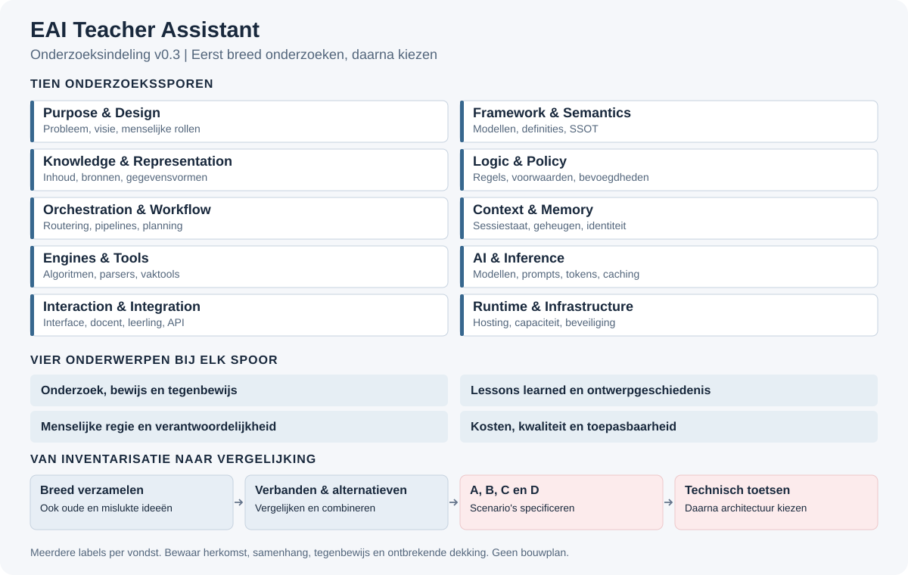

# EAI Teacher Assistant

Onafhankelijk onderzoeks- en ontwikkelproject voor een methodegebonden digitale assistent-leraar.

De vraag: welke ondersteuning kan software geven zonder taalmodel, welke ondersteuning vraagt wel een taalmodel, en wat betekent die keuze voor de kosten en kwaliteit van een volledig leerlinggesprek?

## Vier vergelijkingshypothesen

| Variant | Uitvoering |
| --- | --- |
| A | Reguliere LLM-chatbot met vakinhoud, gesprekshistorie en didactische instructies |
| B | Hetzelfde model met begrensde context, caching en passende antwoordlengte |
| C | Hybride assistent: gecontroleerde hints, foutdetectie en beslisregels, met het model van B als terugval |
| D | Dezelfde hybride route als C, met zelfgehoste open-weight modellen in plaats van betaalde modelaanroepen |

Alle vier worden na het brede onderzoek volledig gespecificeerd. Voor een eerlijke vergelijking blijven de onderwijsfuncties, leerlingomgeving, vakinhoud en toetscriteria gelijk. A–D zijn voorlopig hypothesen, geen architectuurkeuze.

## Onderzoek: eerst breed, daarna kiezen

We onderzoeken oorspronkelijke ontwerpgedachten, technische mechanismen, bewijs en eerdere fouten uit de repositories, oudere versies, boeken, bibliotheek en externe bronnen. Een vondst kan bij meerdere sporen horen. Zie de [onderzoeksindeling en werkwijze](research/ONDERZOEKSINDELING.md).

## Eerst de functies, daarna de les

Het project onderzoekt een assistent die in bestaande digitale lessen kan worden aangesloten. De software krijgt de geldige lesversie, het leerdoel en de grenzen van de ondersteuning uit de leeromgeving. Welke beslissingen zonder model kunnen worden genomen en waar een model nodig blijft, is een onderzoeksvraag.

Frans, 2 havo blijft een eerste beoogde demonstratie; rekenen in groep 7 is een tweede functioneel contrast om vakspecifieke controle te onderzoeken. De bestaande Franse casusschets is voorlopig. We schrijven nog geen volledige lesmethodes: eerst de functionele en technische vergelijking, dan een passende minimale inhoudelijke proef.

Dit is onafhankelijk onderzoek, geïnspireerd op publieke onderwijsopgaven. Geen onderdeel van een bestaande Neon-methode en geen officiële samenwerking met Neon.

## Gebruikersomvang en belasting

Neon meldde op 28 september 2026 ruim 1.500 aangesloten scholen met samen ongeveer 700.000 leerlingen. Dat is potentieel bereik, geen vastgesteld gebruik van de assistent. Het onderzoek bevat drie schaalniveaus: 70.000, 280.000 en 700.000 actieve leerlingen, met verschillende gebruiksintensiteiten. De vier varianten worden op dezelfde belasting vergeleken; gelijktijdigheid en schoolpieken tellen mee.

## Documentatie

- [Plan van aanpak v0.3](docs/PLAN.md)
- [Onderzoeksindeling en werkwijze](research/ONDERZOEKSINDELING.md)
- [Bronnenregister: ronde 01](research/register/RONDE-01.md)
- [Openbare afgeleide van het bronnenregister (29 van 87 repositories)](research/register/public-repositories.json)
- [Verdiepend bronnenonderzoek](research/VERKENNING.md)
- [Functionele vergelijking en ontwerpvoorwaarden](research/FUNCTIONELE-EISEN.md)
- [Technische hergebruiksaudit](research/TECHNIEKAUDIT.md)
- [Minimale technische proeven](benchmarks/TECHNISCHE-PROEVEN.md)
- [Bronnen en aansluiting bij Neon](research/neon/BRONNEN.md)
- [Use case Frans 2 havo](curriculum/french-havo2/USE-CASE.md)
- [Vergelijkingsprotocol](benchmarks/PROTOCOL.md)
- [Gebruikersomvang, capaciteits- en kostenmodel](benchmarks/SCHAALMODEL.md)
- [Hergebruik en rechten](research/HERGEBRUIK.md)

## Status

Onderzoeksopzet v0.3: de brede verkenning is opnieuw geopend. Het volledige interne bronnenregister bevat 87 toegankelijke repositories; 29 openbaar en 58 privé. Het openbare register is alleen de afgeleide daarvan. Private bronnen, eerdere versies en de bibliotheek blijven onderdeel van het onderzoek. De eerste technische selectie blijft beschikbaar als vertrekpunt, niet als definitieve keuze. Eerst verzamelen en kritisch vergelijken, dan A–D specificeren. De definitieve architectuur, licentie-/hergebruikbesluiten en uitvoeringsproeven staan nog open. Er zijn nog geen werkende varianten, modelmetingen of leerlingresultaten in deze repository. De vakinhoud is een ontwerp dat nog door een vakdocent moet worden beoordeeld. Er zijn geen echte leerlinggegevens nodig voor de eerste benchmark.

Geen aangetoonde besparing op een bestaand product. Een eigen model heeft geen externe tokenfactuur, maar wel reken-, hosting- en beheerkosten.
