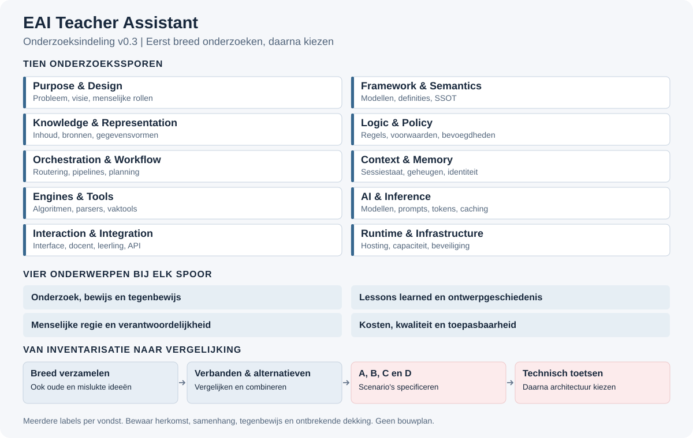

# Plan van aanpak — EAI Teacher Assistant

Versie 0.3, 27 november 2026. De brede verkenning is heropend na een kritische tegenlezing van het onderzoeksontwerp. De eerdere bevindingen blijven bewaard. Deze versie vervangt de volgorde waarin fase 4 direct op de eerste technische selectie zou volgen.

## Onderzoeksvraag

Hoe kan een methodegebonden digitale assistent een leerling passende hulp geven met zo weinig mogelijk onnodige modelaanroepen, zonder verlies van vooraf vastgestelde vakinhoudelijke en didactische kwaliteit?

De aanleiding is de publiek beschreven Digitale Assistent-Leraar van Neon. Het onderzoek is onafhankelijk. We kennen de interne software, gebruiksgegevens en modelkosten van Neon niet. Het doel is een vergelijkbare technische demonstratie en een onderbouwde kostenanalyse, geen claim over besparing op hun huidige product.

## De vier vergelijkingshypothesen

| Variant | Uitvoering |
| --- | --- |
| A | Competente reguliere LLM-chatbot, met relevante vakinhoud en didactische instructies |
| B | Hetzelfde model en dezelfde toegestane hulp, met doelgerichte context, passende antwoordlengte en caching |
| C | Hybride assistent met gecontroleerde inhoud, vakspecifieke controles en beslisregels; hetzelfde model als B voor de resterende modeltaken |
| D | Dezelfde hybride assistent als C; de generatieve modeltaken draaien op een zelfgehost open-weight model, zonder externe model-API |

De definities hierboven zijn voorlopig. Zij begrenzen de zoekruimte niet. Fase 3c specificeert de vier scenario's op basis van de bredere verkenning. Het gemeenschappelijke contract omvat lesinhoud, docentinstellingen, interface, toegestane hulp en kwaliteitscriteria. Technieken worden waar mogelijk afzonderlijk aan- en uitgezet binnen de varianten. Een vergelijking tussen verschillende modelgewichten én hostingvormen is een gecombineerd effect; houd een vergelijking van hetzelfde model bij verschillende hostingvormen apart. Kleinere modellen, browserinferentie, distillatie en een betaalde open-weight API zijn aanvullende onderzoeksopties, geen nieuwe hoofdvarianten. Geen stille externe modelterugval bij D.

## Werkvolgorde

| Fase | Werk | Op te leveren voor besluit |
| --- | --- | --- |
| 1 | Verkenning van Neon, intelligente tutorsystemen, EAI-bronnen en efficiëntie | [Bronnenonderzoek](../research/VERKENNING.md), [Neon-bronnen](../research/neon/BRONNEN.md); feiten, hypotheses en onbekenden gescheiden |
| 2 | Functionele analyse, vóór schrijven van lesinhoud | [Functiematrix](../research/FUNCTIONELE-EISEN.md) met context, leerling/docenthandeling, mogelijke technieken, uitzonderingen, toegestane hulp, bewijs en gebruiksrechten |
| 3a | Brede ideeën- en bronneninventarisatie | [Onderzoeksindeling](../research/ONDERZOEKSINDELING.md): tien onderzoekssporen, oorspronkelijke ontwerpgedachten, historie, code, boeken, proeven, positieve en negatieve resultaten. Ook buiten de eerste technische selectie zoeken; dekking en hiaten expliciet maken |
| 3b | Kritische vergelijking, samenhang en nieuwe combinaties | Bestaande [technische audit](../research/TECHNIEKAUDIT.md) als eerste verzameling kandidaten; vergelijk alternatieven, bewijs en tegenbewijs, voorgangers en opvolgers. Bewaar de relatie tussen visie, inhoud, logica en uitvoering. Geen ongetoetste code of oude semantiek overnemen |
| 3c | A–D volledig functioneel en technisch specificeren | Gedeelde functies en kwaliteitscriteria, verdeling van menselijke en systeemhandelingen, gegevens en bevoegdheden, uitvoeringsroutes, modeltaken, foutpaden, meetcontract en vergelijking van kosten. Onderbouw selectie en resterende onzekerheid vóór technische proeven |
| 4 | Kleine onderscheidende technische proeven | [Technische proeven](../benchmarks/TECHNISCHE-PROEVEN.md): fictieve minimale gevallen, geen volledige methode. P01–P03 (meting, context en route) zijn kandidaten; kies en herzie de proeven na fase 3c. Meet routebereik, contextgetrouwheid, cacheveiligheid, gespecialiseerde controles, klein model versus groter model en netto kosten van extra aanroepen. Geen betaalde tests zonder budgetbesluit |
| 5 | Besluit over architectuur en inhoudscontract | Gedeelde runtime, lesversies en bevoegdheden, model- en kostenadapter, foutcontract, minimale twee contrasterende taken. Vastleggen wat we hergebruiken en wat niet; model/framework/hostingkeuze onderbouwen |
| 6 | Volledige maar afgebakende use cases en beoordelingsset | Frans 2 havo en rekenen groep 7 als beoogde contrasten; vakdocentreview, meerdere geldige oplossingsroutes, gecontroleerde hints, vrije vragen en nieuwe zelfstandige opdrachten. Eerst een kleine verticale proef, daarna voldoende inhoud voor een eerlijke benchmark |
| 7 | Applicatie en vier varianten | Eén leerlingomgeving, één inhoudsbron, vier echt uitvoerbare routes, beveiligde modeladapters en meting; geen vier aparte codebases |
| 8 | Kwaliteits- en modelvergelijking | Bevroren ontwikkelset en aparte ongeziene set, volledige gesprekken, vakdocentbeoordeling, werkelijke kosten en kwaliteit. Eventuele leerlingproef afzonderlijk met passende toestemming |
| 9 | Belasting, schaal en totale kosten | Gelijke aangeboden belasting in A–D; 70.000 / 280.000 / 700.000 als aangenomen actieve aantallen; piek- en dalbelasting, uitval, GPU-benutting, kosten van auteurs en onderhoud, onzekerheid |
| 10 | Demonstratie en overdracht | Werkende demonstratie, broncode, testresultaten, kostenmodel, beperkingen, integratievoorstel en benodigde informatie voor een echte Neon-proef |

Fasen 1 en 2 zijn inhoudelijk gevorderd. Fase 3 is heropend. De eerdere technische selectie blijft een voorlopige inventarisatie. De volgende stap is 3a: breed bronnen en ideeën verzamelen, vervolgens verbanden en tegenbewijs onderzoeken (3b) en A–D specificeren (3c). Gebruik de overgangscriteria uit de [onderzoeksindeling](../research/ONDERZOEKSINDELING.md). De conceptproeven worden nog niet uitgevoerd. Definitieve hergebruikrechten, metingen en architectuurkeuze blijven open. De fasen zijn werkpakketten, geen verplichting tot aparte PR's of CI-trajecten.

## Onderzoeksindeling

De [onderzoeksindeling](../research/ONDERZOEKSINDELING.md) onderscheidt Purpose & Design, Framework & Semantics, Knowledge & Representation, Logic & Policy, Orchestration & Workflow, Context & Memory, Engines & Tools, AI & Inference, Interaction & Integration en Runtime & Infrastructure. Bewijs, ontwerpgeschiedenis, menselijke verantwoordelijkheid, kosten en kwaliteit komen in ieder spoor terug. De indeling is geen voorgeschreven architectuur en mag worden uitgebreid.

De bestaande EAI-projecten zijn een onderzoeksarchief, niet alleen een technische kennisbank. Onderzoek oorspronkelijke intentie, samenhang en technische werking zonder oude rubrics, prompts, schoolgegevens of taxonomie automatisch over te nemen. Beschrijf ook wat niet werkte en waarom. De inhoudelijke referentie blijft versiegebonden. Geen code of niet-openbaar materiaal overnemen zonder rechtencontrole.

## Ontwerpvoorwaarden

- De docent bepaalt leerdoel, lesversie, toegestane steun en het vervolg van de les. De assistent mag geen formele beoordeling of consequential besluit over een leerling nemen in deze proef.
- Scheid vakinhoud, didactische keuzes, uitvoering, bewijs en registratie. Gebruik de EAI Standard 0.5.0-candidate als versiegebonden inhoudelijke referentie; oude EAI-implementaties hebben een eigen versie en mogen de betekenis niet ongemerkt wijzigen. Dit is geen claim van standaardconformiteit.
- Gebruik dezelfde authored bron voor de vier varianten. Bij bewerken, intrekken of vervangen van lesmateriaal worden daarvan afgeleide hints en caches ongeldig totdat ze opnieuw zijn gecontroleerd.
- Neem een leerlingvraag niet aan als volledige context. Autoritatieve lesgegevens komen uit de leeromgeving. Modelafgeleide gegevens zijn voorstellen, geen bevoegdheid om vak, niveau, lesversie of hulpgrens te wijzigen.
- De assistent mag onzeker zijn. Foutpatronen, woordoverlap, zelfrapportage en modelconfidence zijn geen bewezen kennis of beheersing. Houd onbekend en onjuist apart.
- Bewaar alleen de benodigde sessiestaat. Geen langdurig persoonsprofiel, automatische rangschikking, echte leerlinggegevens of productie-integratie in de eerste proef.
- Gebruik beperkte, versiegebonden gedeelde caches uitsluitend waar toestemming, inhoudsversie en ondersteuningscondities gelijk zijn. Geen persoonlijke antwoorden tussen leerlingen of scholen hergebruiken. Prefixcache, antwoordcache en vaste goedgekeurde hints afzonderlijk meten.
- Validatie moet vóór publicatie van het antwoord plaatsvinden waar een inhoudelijke of privacygrens dat vraagt; promptregels of patroonfilters alleen zijn geen afdoende beveiliging.
- API-sleutels server-side; geen leerlinggegevens, vertrouwelijke stukken of private broncode in deze openbare repo. Licentiecontrole vóór overname.
- Houd ontwikkel- en simulatiegegevens gescheiden van werkelijke inferentieruns en eventuele leerlinggegevens. Bevries criteria vóór de beslissende test. Geen succesclaim uit mockdata of alleen een geldig uitvoerschema.
- CI blijft snel, gericht en zonder betaalde modelaanroepen. Live tests zijn handmatig, afgebakend en budgetbegrensd.

## Onderzoeksbesluiten en grenzen

Er is geen verplicht framework, model of hostingplatform gekozen. Techniek die al voldoet wordt niet vervangen omwille van een nieuwe architectuur. Een complexe agentopzet of langdurig leerlinggeheugen is alleen zinvol wanneer een concrete proef de noodzaak toont. Bepaal eerst welke informatie nodig is, wat al beschikbaar is en welke handeling de leerling zelf moet uitvoeren.

Zie [de verdiepende verkenning](../research/VERKENNING.md), [functionele eisen](../research/FUNCTIONELE-EISEN.md), [hergebruik](../research/HERGEBRUIK.md), [vergelijkingsprotocol](../benchmarks/PROTOCOL.md) en [schaalmodel](../benchmarks/SCHAALMODEL.md). De daadwerkelijke acceptatiegrenzen, modellen, capaciteit en kosten worden nog vastgesteld en gemeten.
