# EAI Teacher Assistant | Onderzoeksatlas

27 november 2026. Elf diagrammen tonen een beperkte openbare selectie van eerdere bronvondsten en voorgestelde technische vergelijking. Ze vervangen het interne register niet. De selectie is onvoldoende als basis voor het afsluiten van 3b/3c; deze fasen zijn gericht heropend. Fase 4a staat stil tot herbeoordeling. Historische proeven zijn niet opnieuw uitgevoerd.

[Historische HTML-atlas](archief-v1.html) (download en open lokaal) · [Machineleesbaar bronnen- en blokregister](atlas-registry.json) · [Technische specificatie](../../../research/TECHNISCHE-SPECIFICATIE.md) · [P01–P03](../../../benchmarks/TECHNISCHE-PROEVEN.md)

## Tussenstand detailronde 09

De eerste gerichte passage omvat 92 bekende repositorynamen: 86 met een bronpassage (waaronder twee snapshots met alleen een README), vijf opnieuw leeg bevonden en één eigen onderzoeksproject. Vijftien namen hebben een expliciet beperkte bron- of verdiepingsstatus. Ook bij de overige bronnen zijn integratie en uitvoering niet volledig getoetst. Dit zijn geen 92 onafhankelijke projecten. Deze openbare update bevat 34 onderzoeksrecords uit 27 openbare repositories.

Alle bronnen zijn versiegebonden. Code-inspectie, ontwerp, schema en gelezen tests zijn afzonderlijke bewijssoorten. Geen nieuwe runtime- of modeltests. Fase 3b en 3c zijn heropend; fase 4a blijft NO-GO. Geen gekozen architectuur, vakinhoud, modelkeuze of kostenclaim.

[Alle 34 openbare onderzoeksrecords](../../../research/register/RONDE-09.md)

## Aanvulling uit besloten bronnen

De eerdere openbare selectie van 34 records blijft intact. De onderstaande aanvulling brengt ook de bruikbare mechanismen uit besloten projecten in beeld. Overlap tussen afgeleide records en openbare bronvondsten is mogelijk; de aantallen zijn geen aantal unieke algoritmen.

Deze selectie bevat 38 inhoudelijke afgeleiden uit eerder onderzochte besloten bronbestanden, testbestanden en ontwerpstukken. Zij beschrijven de aangetroffen technische ideeën en noodzakelijke tegenproeven in eigen woorden. De oorspronkelijke private bestanden, namen, bronlinks, code en instellingen worden niet gepubliceerd. De afzonderlijke interne bronkoppelingen blijven bewaard in het besloten onderzoek. Publieke lezers kunnen die besloten bronclaims niet zelfstandig via deze afgeleide controleren. De afgeleide is geen extra onafhankelijke bewijsbron, geen uitvoeringsresultaat en geen toestemming voor codehergebruik.

[De 38 technische afgeleiden](../../../research/register/RONDE-09-AFGELEID.md)

## 01. Zes vondsten, drie ontwerpvragen

Openbare bronronde 01: groepering op overeenkomstige onderzoeksvraag.

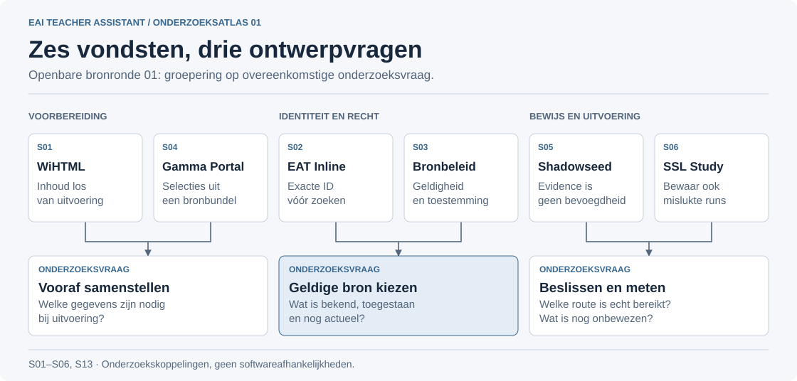

[SVG openen](d01-kenniskaart.svg)

## 02. Ontwerpgeschiedenis in vijf momenten

Kalenderdagen bepalen de afstand. Bronnen zijn niet automatisch elkaars opvolgers.

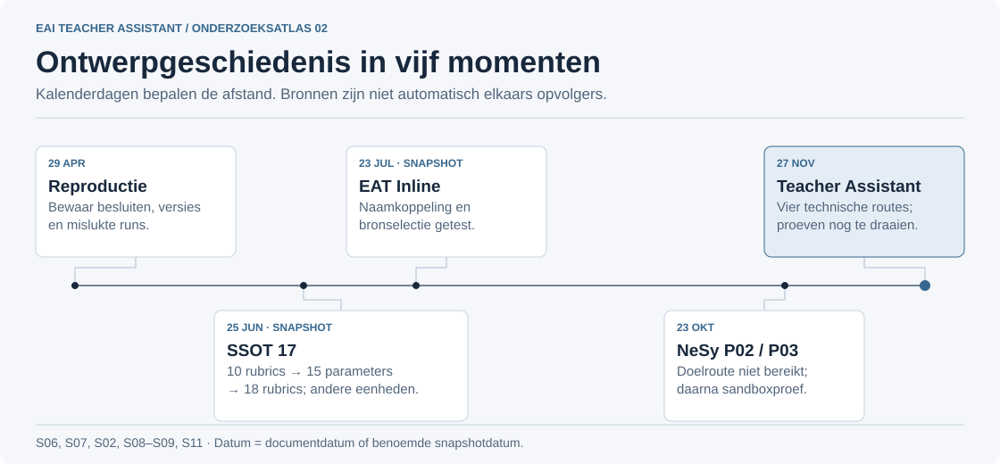

[SVG openen](d02-ontwerpgeschiedenis.svg)

## 03. Veertien mechanismen, vier onderzoeksgroepen

Wat houden we gelijk? Wat veranderen we afzonderlijk in de vergelijking?

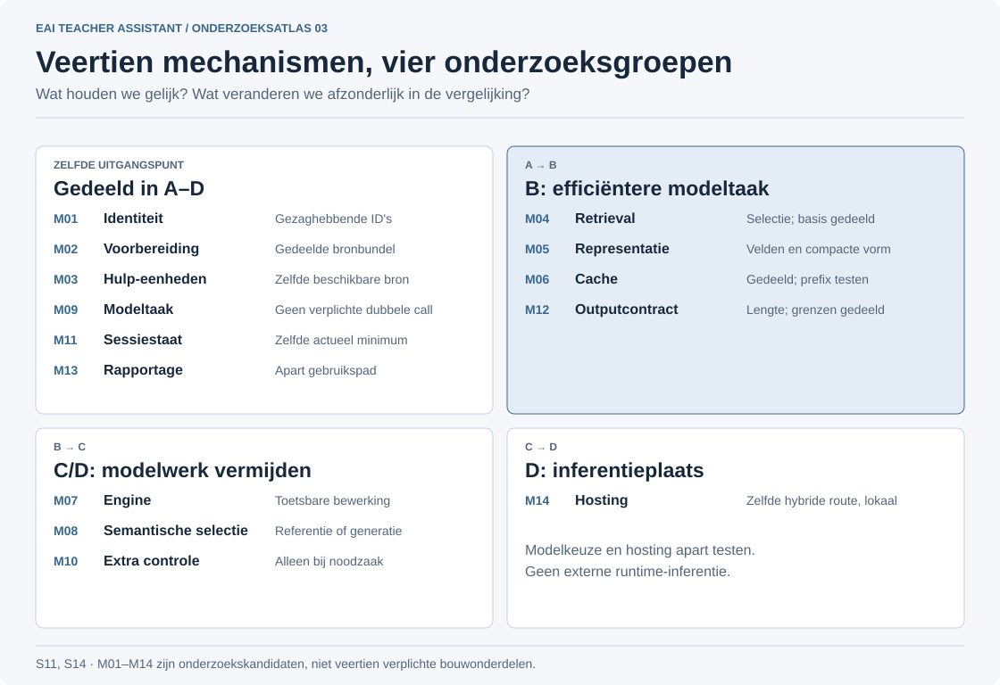

[SVG openen](d03-mechanismen.svg)

## 04. Wat verandert er tussen A, B, C en D?

Eén gedeeld contract. Alleen benoemde verschillen veranderen per route.

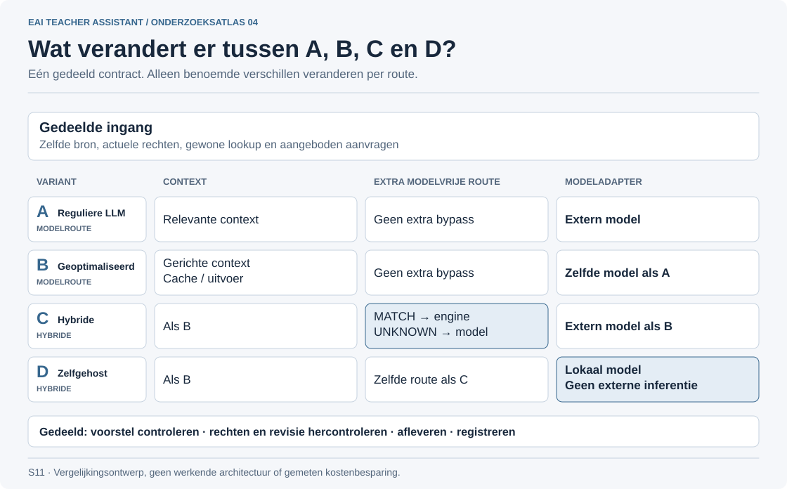

[SVG openen](d04-varianten-abcd.svg)

## 05. Van bronbevinding naar proef

Vijf traceerbare koppelingen. De verificaties staan nog open in dit project.

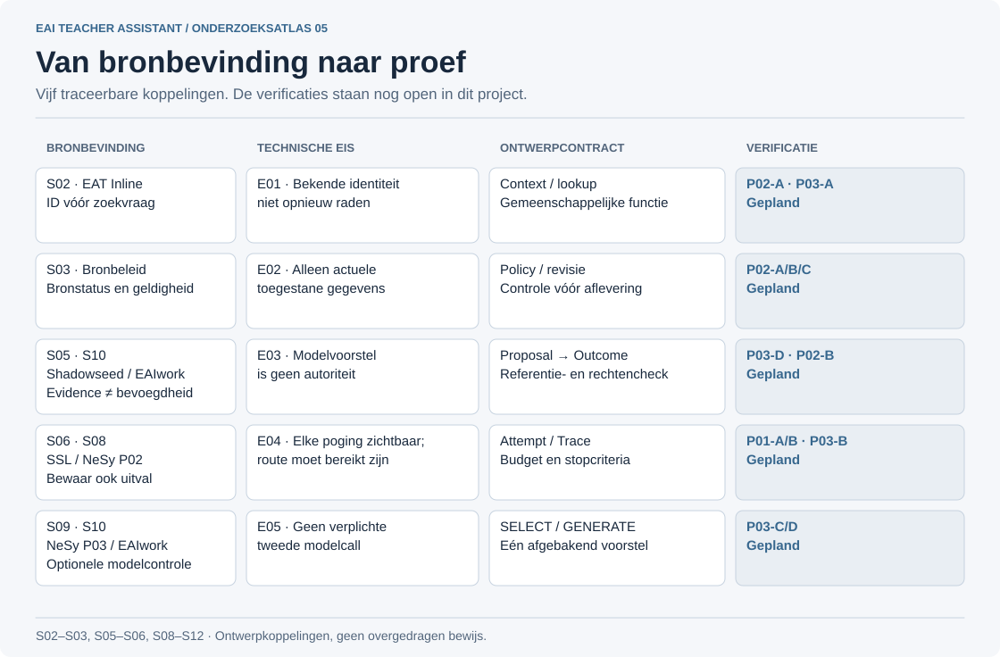

[SVG openen](d05-bewijsroute.svg)

## 06. Wat eerdere proeven werkelijk aantonen

Twee experimentfamilies. De cijfers zijn niet onderling vergelijkbaar.

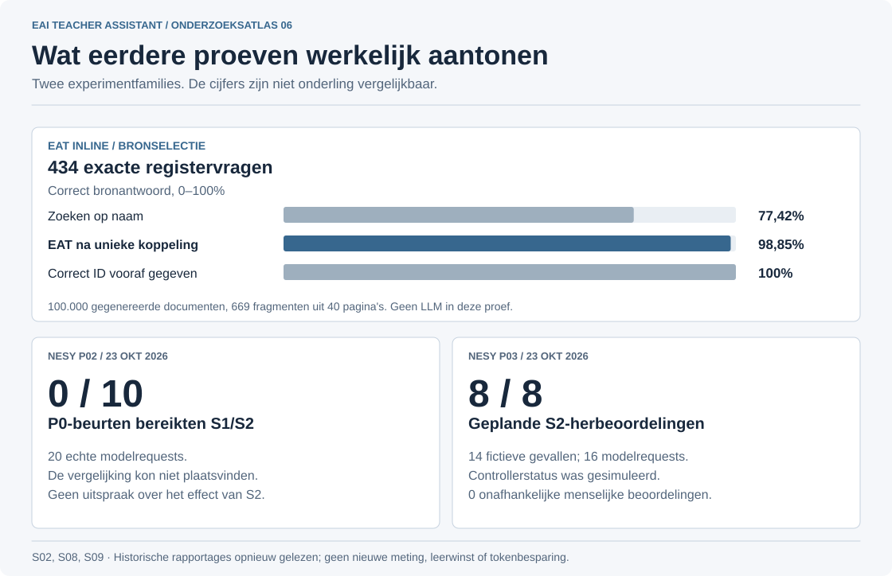

[SVG openen](d06-eerdere-proeven.svg)

## 07. Orchestrator: eerst een toegestane route

C/D: beslis alleen met actuele gegevens. Onbekend is geen toestemming.

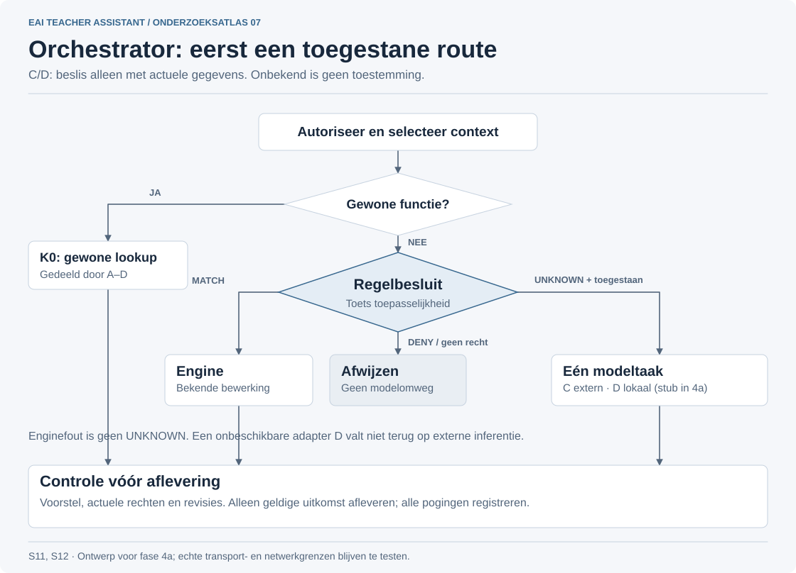

[SVG openen](d07-orchestrator.svg)

## 08. Vijf onderzoeksgroepen uit de detailronde

Concrete bronvondsten naast elkaar. Geen voorgeschreven uitvoeringsvolgorde.

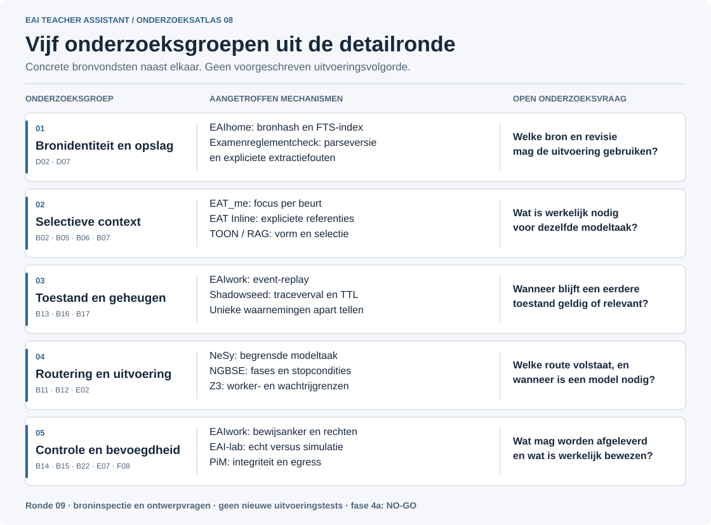

[SVG openen](d08-detailronde.svg) · [Detailregister ronde 09](../../../research/register/RONDE-09.md)

## 09. Technische afgeleiden uit besloten bronnen

Vijf onderzoeksgroepen, 38 records. Vergelijk mechanismen vóór een architectuurkeuze.

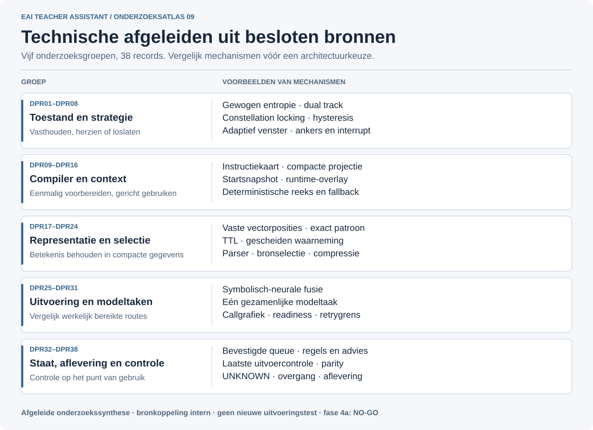

[SVG openen](d09-besloten-mechanismen.svg) · [38 technische afgeleiden](../../../research/register/RONDE-09-AFGELEID.md)

## 10. Historische mechanismen en tegenproeven

De vijftien eerder beperkt onderzochte repositorynamen zijn gericht herlezen. De oorspronkelijke compilerbestanden zijn niet teruggevonden. Deze 26 records verdiepen ontwerpcontracten, uitvoerpaden, isolatie en historische meetresultaten.

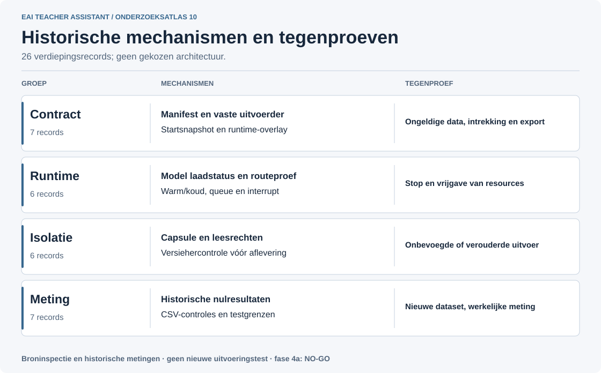

[SVG openen](d10-historische-verdieping.svg) · [26 verdiepingsrecords](../../../research/register/RONDE-10-VERDIEPING.md)

## 11. Van bronvondst naar toetsbare techniek

Vier Exa-zoekrichtingen met twintig gevraagde resultaatplaatsen, vijf openbare repositories op vaste commits en drie historische eigen projecten gericht herlezen. Veertien verdiepingsrecords; geen veertien nieuwe onafhankelijke algoritmen.

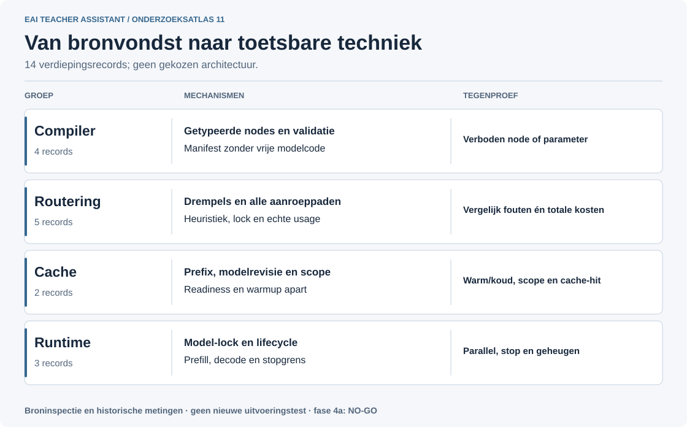

[SVG openen](d11-mechanismen-vergelijking.svg) · [14 verdiepingsrecords](../../../research/register/RONDE-11-VERGELIJKING.md)

Fase 3b en 3c zijn heropend. Fase 4a blijft NO-GO. Geen nieuwe runtime- of modeltests, echte inferentie, vakinhoud, architectuurkeuze of bewezen kostenbesparing. De volledige bronkoppeling blijft intern; een afgeleide is geen extra onafhankelijke bron.

## Bronregister

Broncodes verwijzen naar openbare, versiegebonden bronnen. Hetzelfde register is machineleesbaar. Elk benoemd blok heeft een vaste `data-block-id`, broncodes en een bewijsstatus in SVG en JSON. Een geplande proef is geen verificatieresultaat. Lijnen tonen de beschreven relatie, niet automatisch afstamming, causaliteit of softwareafhankelijkheid.

| ID | Bron | Bewijssoort | Afbakening |
| --- | --- | --- | --- |
| S01 | [WiHTML · ontwerpafspraken](https://github.com/E-AI-MODEL/wihtml/blob/449d9d9ec3d0f883bd190fc5287eaccfe1d87854/docs/ontwerpafspraken.md) | Ontwerp | Inhoud, lesvolgorde en uitvoering gescheiden; geen bewezen tutor. |
| S02 | [EAT Inline · bronselectieproef](https://github.com/E-AI-MODEL/EAT-inline/blob/0bd184f5408bddb9211b9684d7a0ada78a593b8b/benchmark/results/wiki-fair-v2-one-tag-rag/one-tag-rag-summary.md) | Historische meting | 434 exacte registervragen; 100.000 gegenereerde documenten uit 669 fragmenten van 40 pagina's. Geen LLM. |
| S03 | [Examenreglementcheck · bronbeleid](https://github.com/E-AI-MODEL/Examenreglementcheck/blob/d72dc4806566b9c05f0d8f90f41b972390d5beb5/docs/SOURCE-POLICY.md) | Beleidsontwerp | Identiteit, geldigheid en bevoegdheid onderscheiden; geen juridische regels overgenomen. |
| S04 | [Gamma Portal · SSOT-selectors](https://github.com/E-AI-MODEL/eai-gamma-portal/blob/444d1373f83dcd2d5ace6f0ad931c448874b7807/src/lib/ssot-selectors.ts) | Code-inspectie | Selecties met bronverwijzingen; geen bewezen tutorwerking. |
| S05 | [Shadowseed Agent Lab · evidence en invloed](https://github.com/E-AI-MODEL/shadowseed-agent-lab/blob/d50971ac8aed51e1f4442ff3baac9328e36ad75e/docs/architecture-decisions/0002-rag-as-evidence-not-influence.md) | Ontwerpbesluit | Gevonden informatie krijgt niet automatisch invloed; uitvoering niet opnieuw geverifieerd. |
| S06 | [Shadow Seed Study · reproductienotitie](https://github.com/E-AI-MODEL/shadow-seed-study/blob/ff639cc8c079cabef06c4d8cd9bcfb90c72a3b40/docs/ssl/notitie_reproductie.md) | Methode | 29 april 2026: beslissingen, versies, ruwe resultaten en mislukte runs bewaren. |
| S07 | [SSOT 17 · migratiekaart](https://github.com/E-AI-MODEL/SSOT_17/blob/66a48584ed5818790828c1a0fdc41b9a1880df43/docs/11_MIGRATION_MAP.md) | Versiemapping | Snapshot 25 juni 2026: 10 rubrics, 15 Gamma-parameters, 18 operationele rubrics; verschillende eenheden. Geen effectmeting of hergebruikrecht. |
| S08 | [NeSy P02 · postmortem](https://github.com/E-AI-MODEL/eainesy/blob/e8ce553a3c1c16d072078a62c426ce038cc455d3/docs/NeSy-P02-run-failure-root-cause-2026-10-23.md) | Mislukte historische proef | 23 oktober 2026: 0/10 P0-beurten bereikte de onderzochte S1/S2-route; 20 echte modelrequests. Geen vergelijking van S1/S2. |
| S09 | [NeSy P03 · resultaat](https://github.com/E-AI-MODEL/eainesy/blob/e8ce553a3c1c16d072078a62c426ce038cc455d3/docs/NeSy-P03-result-2026-10-23.md) | Historische sandboxmeting | 14 fictieve gevallen; 8/8 S2-herbeoordelingen; 6 controles zonder extra call; 16 modelrequests; 0 onafhankelijke menselijke beoordelingen. Controllerstatus gesimuleerd. |
| S10 | [EAIwork · model-capability neutral](https://github.com/E-AI-MODEL/EAIwork-/blob/8754936ffe594766339e8f8493c963c41a0b4206/docs/model-capability-neutral.md) | Implementatiebeschrijving | Optionele voorstelcontrole; gewone directe modelroute behouden. Exact citaat bewijst geen semantische steun. |
| S11 | [Technische specificatie v0.1](https://github.com/E-AI-MODEL/EAI-teacher-assistent/blob/f19d9b8885fad221524a28dacd2a2aecae3aa056/research/TECHNISCHE-SPECIFICATIE.md) | Projectontwerp | Gedeeld contract A–D; geen werkende architectuur. |
| S12 | [Technische proeven P01–P03](https://github.com/E-AI-MODEL/EAI-teacher-assistent/blob/f19d9b8885fad221524a28dacd2a2aecae3aa056/benchmarks/TECHNISCHE-PROEVEN.md) | Geplande verificatie | Nog niet uitgevoerde modelvrije contractproeven. |
| S13 | [Openbare bronronde 01](https://github.com/E-AI-MODEL/EAI-teacher-assistent/blob/f19d9b8885fad221524a28dacd2a2aecae3aa056/research/register/RONDE-01.md) | Openbaar bronnenregister | Zes bronvondsten met beperkingen. |
| S14 | [Technische audit](https://github.com/E-AI-MODEL/EAI-teacher-assistent/blob/f19d9b8885fad221524a28dacd2a2aecae3aa056/research/TECHNIEKAUDIT.md) | Technische verkenning | Kandidaatmechanismen; geen nieuwe runtimeproef. |

| S15 | [EAT_me · CycleManager / focused_rubric_ids](https://github.com/E-AI-MODEL/EAT_me/blob/deda94ffb80c4c9b78f40afe23d2db09e65673ea/eatme/cycle.py) | Code-inspectie | Ronde 09, B02: Een klein relevant kader per beurt i.p.v. alle definities. Onbekende fase geeft lege set; wrap van buren ook bij loop=false. Volg echte promptconsumer. |
| S16 | [EAT_me · EATRuntimeGatekeeper.evaluate_turn](https://github.com/E-AI-MODEL/EAT_me/blob/deda94ffb80c4c9b78f40afe23d2db09e65673ea/eatme/engine.py) | Code-inspectie | Ronde 09, B03: Rewrite en observe apart meten; geen automatische tweede call of runtimeautoriteit afleiden. |
| S17 | [EAT-inline · parse_references / validate_reference](https://github.com/E-AI-MODEL/EAT-inline/blob/0bd184f5408bddb9211b9684d7a0ada78a593b8b/src/eat_inline.py) | Code-inspectie | Ronde 09, B05: Een syntactisch geldige ref kan inhoudelijk verkeerd, ingetrokken of onbekend zijn. Combineer identiteit met autorisatie, niet fuzzy-healing. |
| S18 | [toon · assertExpectedCount / validateNoExtraTabularRows / validateNoBlankLinesInRange](https://github.com/E-AI-MODEL/toon/blob/7f8c2379fd4cd3399a0e41e79dcc807cdf2b8f3c/packages/toon/src/decode/validation.ts) | Code-inspectie | Ronde 09, B06: Syntaxvalidatie en roundtrip los van werkelijk tokenizerverbruik. Externe library/fork: licentie en versiecheck vóór hergebruik. |
| S19 | [-rag-eat-starter-kit · load_corpus / HybridIndex / _minmax](https://github.com/E-AI-MODEL/-rag-eat-starter-kit/blob/1c98f0d04a179fc8df40383870c81d032385ee50/src/ragkit/retrieval.py) | Code-inspectie | Ronde 09, B07: Filter bronnen op toegestane groepen vóór rangschikking. Uniforme score is geen confidence. Opslagcompressie en retrievalkwaliteit zijn geen bewijs van modelkwaliteit. |
| S20 | [-rag-eat-starter-kit · validate_boundary / compress_file / compress_tree](https://github.com/E-AI-MODEL/-rag-eat-starter-kit/blob/1c98f0d04a179fc8df40383870c81d032385ee50/src/ragkit/gzip_boundary.py) | Code-inspectie | Ronde 09, B08: Opslagbytes apart van tokens; compressie-/expansielimieten, checksums en exacte duplicate-identiteit testen. |
| S21 | [eainesy · buildSymbolicPlan / validateNeuralRecheck](https://github.com/E-AI-MODEL/eainesy/blob/b1962011d2db745ce62dee332c12ec030e8e07f2/research/nesy-cooperative/coordinator.mjs) | Code-inspectie | Ronde 09, B11: Kandidaat blijft unverified_model_claim; controller en transport apart toetsen. Historische P02/P03-resultaten staan in de bestaande atlas. SAT bewijst geen semantische juistheid. |
| S22 | [eainesy · pumpQueue / startWorker / validCertificate](https://github.com/E-AI-MODEL/eainesy/blob/b1962011d2db745ce62dee332c12ec030e8e07f2/src/lib/eainesy/z3-isolated.ts) | Code-inspectie | Ronde 09, B12: Per proces, geen productiecapaciteitsmeting. Timeout, kill en close onderscheiden. Solver toetst alleen formele invoer. |
| S23 | [EAIwork- · apply / replay](https://github.com/E-AI-MODEL/EAIwork-/blob/69f5793f633ae6be6e22ef6c8eeeab5158fe147e/packages/core/src/replay.ts) | Code-inspectie | Ronde 09, B13: Checksum dekt alleen statusparen, niet volledige staat. Onbekende event/replayconfig en wijzigingen in dependencies toetsen. |
| S24 | [EAIwork- · observeLocalEvidence](https://github.com/E-AI-MODEL/EAIwork-/blob/69f5793f633ae6be6e22ef6c8eeeab5158fe147e/packages/evidence/src/observe.ts) | Code-inspectie | Ronde 09, B14: Geen semantische juistheid of verhoging van bewijsstatus uit een exact anker. Read-only sidecar. |
| S25 | [EAIwork- · canRead / canWrite / canRunCheck / canRunWorker / canAudit](https://github.com/E-AI-MODEL/EAIwork-/blob/69f5793f633ae6be6e22ef6c8eeeab5158fe147e/packages/server/src/authz.ts) | Code-inspectie | Ronde 09, B15: Volg werkelijk serverpad en egress; execute-only betekent niet automatisch geheimhouding of correcte aflevering. |
| S26 | [shadowseed-pro · decay_traces / reactivate_by_text / expire_vector_only_open_seeds](https://github.com/E-AI-MODEL/shadowseed-pro/blob/7427181c50fabae8f9cbd112c3e549e752edf914/src/shadowseed/lifecycle.py) | Code-inspectie | Ronde 09, B16: Tijd en turns valideren; reactivering geeft geen nieuw bewijs of gewicht. Autoriteit bij daadwerkelijk gebruik controleren. |
| S27 | [shadowseed-pro · RecurrenceClusterer.add / bump / _credit_observation](https://github.com/E-AI-MODEL/shadowseed-pro/blob/7427181c50fabae8f9cbd112c3e549e752edf914/src/shadowseed/recurrence_clustering.py) | Code-inspectie | Ronde 09, B17: Legacy zonder ref behoudt member-count. Unieke opslagrecord ≠ onafhankelijke observatie; toets clusterdrift, lege/onjuiste refs, herimport. |
| S28 | [shadowseed-pro · recognize / parse_answer](https://github.com/E-AI-MODEL/shadowseed-pro/blob/7427181c50fabae8f9cbd112c3e549e752edf914/src/shadowseed/recurrence_recognition.py) | Code-inspectie | Ronde 09, B18: Slechts herkenningssignaal, geen bewijs/weight/authority. Vergelijk met eenvoudige exacte en semantische clustering; echte extra calls meetellen. |
| S29 | [shadowseed · test_atomic_seed_passes / test_broad_seed_fails](https://github.com/E-AI-MODEL/shadowseed/blob/5c0211114993a9cc47f16a669b38960598a50f27/tests/test_atomic_seed_validation.py) | Testinspectie | Ronde 09, B19: Aanwezige test, niet uitgevoerd. Implementatie en grensgevallen moeten nog worden gelezen; geen bewezen algemene atomiciteit. |
| S30 | [shadowseed-agent-lab · SeedProposer / RetrieverProtocol / AgentLabHarness.run_loop](https://github.com/E-AI-MODEL/shadowseed-agent-lab/blob/d50971ac8aed51e1f4442ff3baac9328e36ad75e/shadowseed_agent_lab/harness.py) | Code-inspectie | Ronde 09, B20: Geen autoriteit vanuit retrieval of voorstel. Bounded loop, stop/fixpoint en caller verder controleren; fake proposer geen modelkwaliteit. |
| S31 | [shadow-seed-study · searchSeedsTool / getRunTool / recentSeedsTool](https://github.com/E-AI-MODEL/shadow-seed-study/blob/ff639cc8c079cabef06c4d8cd9bcfb90c72a3b40/src/lib/mcp/tools/lab.ts) | Code-inspectie | Ronde 09, B21: Toolaanroep of JSON-resultaat bewijst geen autorisatie of bronjuistheid; lees werkelijk scopefilter. |
| S32 | [EAI-lab- · EventStore.append / all / for_case](https://github.com/E-AI-MODEL/EAI-lab-/blob/7c76ed3426e1a478c726ceecc2136e96fe671c95/src/eai_lab/event_store.py) | Code-inspectie | Ronde 09, B22: Proceslokaal. Fake vs real afdwingen bij producer en import; geen duurzaamheid, onafhankelijke evidence of providerusage afleiden. |
| S33 | [Caveman-eduNL · docs/OUTPUT_CONTRACTS.md](https://github.com/E-AI-MODEL/Caveman-eduNL/blob/342e88d98a35640cfb9431280dfa6e34e2a7a4a8/docs/OUTPUT_CONTRACTS.md) | Ontwerp | Ronde 09, C04: Bruikbaar als ontwerpreferentie voor taakspecifieke vorm en omvang; documentatie, geen gemeten tokensparing. |
| S34 | [door0101 · src/components/chat/AuthenticatedChatOverlay.tsx](https://github.com/E-AI-MODEL/door0101/blob/95b57b6caf0140317d69caabc7d239edcac65904/src/components/chat/AuthenticatedChatOverlay.tsx) | Code-inspectie | Ronde 09, C08: Bruikbare scheiding tussen bekende velden en vrije tekst; serverautorisatie, concurrentie en feitelijke faseovergangen nog controleren. |
| S35 | [eai-gamma-portal · src/lib/advice-builder.ts](https://github.com/E-AI-MODEL/eai-gamma-portal/blob/444d1373f83dcd2d5ace6f0ad931c448874b7807/src/lib/advice-builder.ts) | Code-inspectie | Ronde 09, C10: Relevante traceerbare bevindingen-naar-advies-laag. matchedNeedle is alleen tekstindicatie, niet automatisch bewijs van werking. |
| S36 | [EAI-standard · schemas/conformance-result.schema.json](https://github.com/E-AI-MODEL/EAI-standard/blob/dd674400c5ce394b90a80b944f672dc90b3c912a/schemas/conformance-result.schema.json) | Schema-inspectie | Ronde 09, C14: Essentieel onderscheid: geldige structuur en volledigheid van kennis zijn verschillende dingen. Historisch schema; niet automatisch huidige standaard of certificering. |
| S37 | [EAIhome · src/eaihome/store.py](https://github.com/E-AI-MODEL/EAIhome/blob/52356fc75097da7f6361739f29d49182cc9d0b2a/src/eaihome/store.py) | Code-inspectie | Ronde 09, D02: Bronopslag, integriteitscontrole en herbouwbare zoekindex zijn in code aangetroffen. De CLI-groepsfilter is geen echte authenticatie. Tekstmatch bewijst niet dat een claim klopt. |
| S38 | [EAIhome · src/eaihome/search.py](https://github.com/E-AI-MODEL/EAIhome/blob/52356fc75097da7f6361739f29d49182cc9d0b2a/src/eaihome/search.py) | Code-inspectie | Ronde 09, D02: Bronopslag, integriteitscontrole en herbouwbare zoekindex zijn in code aangetroffen. De CLI-groepsfilter is geen echte authenticatie. Tekstmatch bewijst niet dat een claim klopt. |
| S39 | [Examenreglementcheck · app/parser.py](https://github.com/E-AI-MODEL/Examenreglementcheck/blob/d72dc4806566b9c05f0d8f90f41b972390d5beb5/app/parser.py) | Code-inspectie | Ronde 09, D07: Scheiding documentidentiteit, inhoud, parseversie en bronstatus. Extractiefouten moeten bewaard blijven; hash is geen autorisatie of juridische juistheidscontrole. |
| S40 | [gpt-oss · tests/test_responses_api.py](https://github.com/E-AI-MODEL/gpt-oss/blob/89fe402d10a59879781a1eb0a64affdf4c278a4d/tests/test_responses_api.py) | Testinspectie | Ronde 09, D10: Protocoltests met stubs los houden van echte inferentie, snelheid en modelkwaliteit. Externe codebron; tests niet uitgevoerd. |
| S41 | [legit-eai-ai-tool · src/data/sagaPresets.ts](https://github.com/E-AI-MODEL/legit-eai-ai-tool/blob/4d4c49a9a0f793c2ce8a17d6a273bc2c7e90413c/src/data/sagaPresets.ts) | Data-inspectie | Ronde 09, D12: Vaste taken en templates als data; geen bewezen juridische correctheid of runtime-policy in gelezen bestand. |
| S42 | [malaga-magic-maker · supabase/functions/receipt-extract/validation.test.ts](https://github.com/E-AI-MODEL/malaga-magic-maker/blob/090f799164ea79de45f60f831287d6e83b81dd03/supabase/functions/receipt-extract/validation.test.ts) | Testinspectie | Ronde 09, D13: Sterke concrete negatieve fixtures voor input- en privacycontract. Testcode gelezen, niet uitgevoerd; corresponderende productiehandler nog volgen. |
| S43 | [NGBSE20.1 · src/ngbse20/runtime/orchestrator.py](https://github.com/E-AI-MODEL/NGBSE20.1/blob/d6e0d49975bac15583886de49b828324c07fe519/src/ngbse20/runtime/orchestrator.py) | Code-inspectie | Ronde 09, E02: Expliciete fases en stopcondities. Controleer de foutcontracten per fase en begrens dynamische loaders. Geen uitvoeringstest. |
| S44 | [NGBSE20.1 · src/ngbse20/runtime/collector_manager.py](https://github.com/E-AI-MODEL/NGBSE20.1/blob/d6e0d49975bac15583886de49b828324c07fe519/src/ngbse20/runtime/collector_manager.py) | Code-inspectie | Ronde 09, E02: Expliciete fases en stopcondities. Controleer de foutcontracten per fase en begrens dynamische loaders. Geen uitvoeringstest. |
| S45 | [open-lovable · lib/file-parser.ts](https://github.com/E-AI-MODEL/open-lovable/blob/efdef874d7c24a9e48fdb0f96652021e96fd9f92/lib/file-parser.ts) | Code-inspectie | Ronde 09, E04: Gerichte bronselectie vanuit codestructuur in plaats van alle bestanden in prompt. Regexheuristiek, geen robuuste AST of uitvoeringstest; externe codebron. |
| S46 | [presentatie-door010 · src/lib/mcp/tools/get-conversation-messages.ts](https://github.com/E-AI-MODEL/presentatie-door010/blob/01b83191e95129bf7b010b728b2e240683a7ee6b/src/lib/mcp/tools/get-conversation-messages.ts) | Code-inspectie | Ronde 09, E06: Selectieve, gebruikersgebonden toolroute. Werkelijke RLS en intrekking apart verifiëren; geen echte gespreksrecords opgevraagd. |
| S47 | [project-pim · src/lib/pim/modelIntegrity.ts](https://github.com/E-AI-MODEL/project-pim/blob/840ad1f70b5d86eb9058b08f8d9d649b8773f243/src/lib/pim/modelIntegrity.ts) | Code-inspectie | Ronde 09, E07: Zeer relevant: lokale eerste hash is geen onafhankelijke verificatie; controleer feitelijk uitgaande payload en bestemming. modelVerified-default nader toetsen. |
| S48 | [project-pim · src/lib/pim/engine/engine.ts](https://github.com/E-AI-MODEL/project-pim/blob/840ad1f70b5d86eb9058b08f8d9d649b8773f243/src/lib/pim/engine/engine.ts) | Code-inspectie | Ronde 09, E07: Zeer relevant: lokale eerste hash is geen onafhankelijke verificatie; controleer feitelijk uitgaande payload en bestemming. modelVerified-default nader toetsen. |
| S49 | [website · scripts/build_site.py](https://github.com/E-AI-MODEL/website/blob/18140dee2ab0e74007bff3dba7218dd1e3d89401/scripts/build_site.py) | Code-inspectie | Ronde 09, E13: Data en bouwlogica gescheiden. De actuele release, runtime en browserwerking zijn niet in deze passage gecontroleerd. |
| S50 | [LeerlingMemo2 · test/rules/firestore-rules.spec.ts](https://github.com/eaimodel5/LeerlingMemo2/blob/6e8fa371812ac1b2905e6f125b0f73c4206eaff9/test/rules/firestore-rules.spec.ts) | Testinspectie | Ronde 09, F08: Gerichte test voor actuele gebruiksrechten, ook na intrekking. Testcode gelezen, niet uitgevoerd; koppeling aan actieve regels nog te controleren. |

| S51 | [Ronde 09 · openbare technische afgeleiden](../../../research/register/RONDE-09-AFGELEID.md) | Afgeleide onderzoekssynthese | Besloten herkomst alleen intern verifieerbaar. Geen afzonderlijke openbare broninspectie of nieuw testbewijs. |

| S52 | [Ronde 10 · Historische mechanismen en tegenproeven](../../../research/register/RONDE-10-VERDIEPING.md) | Onderzoekssynthese | 26 records; openbare bronnen waar geverifieerd, overige koppelingen intern. |
| S53 | [Ronde 11 · Van bronvondst naar toetsbare techniek](../../../research/register/RONDE-11-VERGELIJKING.md) | Onderzoekssynthese | 14 records; openbare bronnen waar geverifieerd, overige koppelingen intern. |

## Vormgeving en onderhoud

Geïnspireerd door [Diagram Design van Cathryn Lavery](https://github.com/cathrynlavery/diagram-design/tree/795eec47fd376e5dda0b9e056a49520060cd2f13) (MIT). Eigen HTML/SVG met het bestaande projectpalet, sobere typografie, orthogonale verbindingen, één accentkleur en afzonderlijke bronmetadata. Geen upstream code of assets gekopieerd, geen nieuwe afhankelijkheid. De SVG's zijn bewerkbaar; het HTML-bestand bundelt exact dezelfde beelden zonder externe fonts of scripts. Houd bij wijzigingen SVG, HTML en register in overeenstemming. De atlas is een openbare selectie, geen volledige interne inventarisatie.
