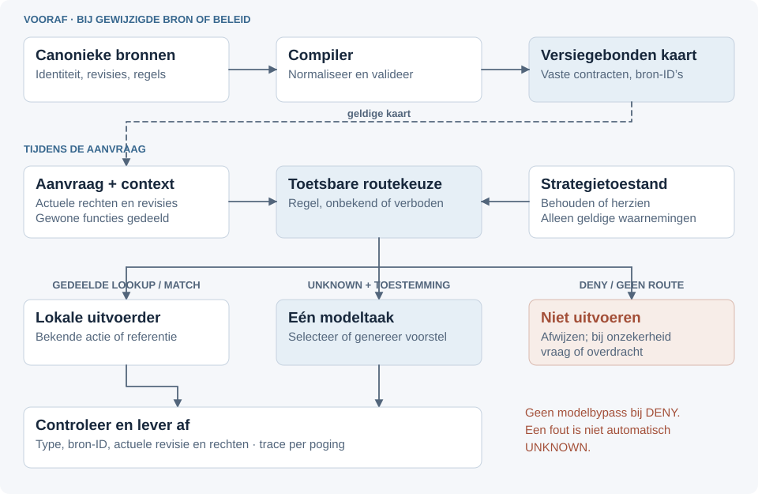
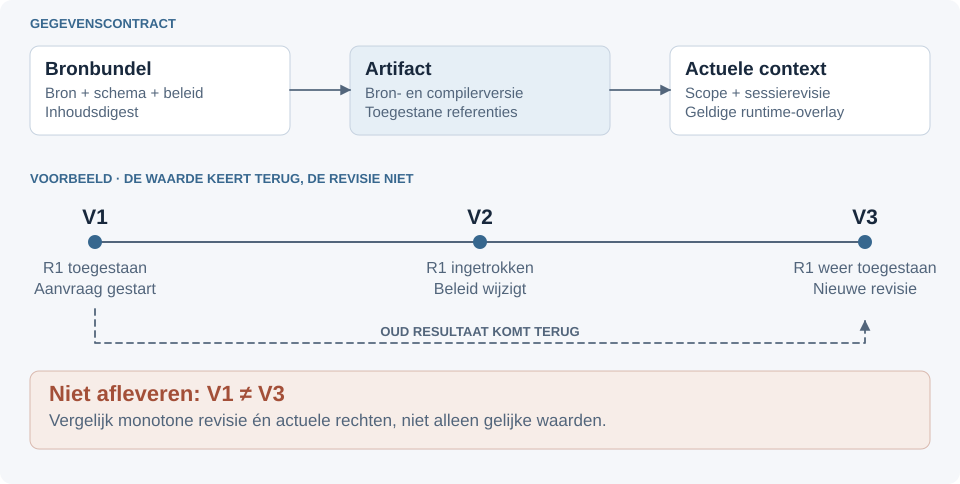
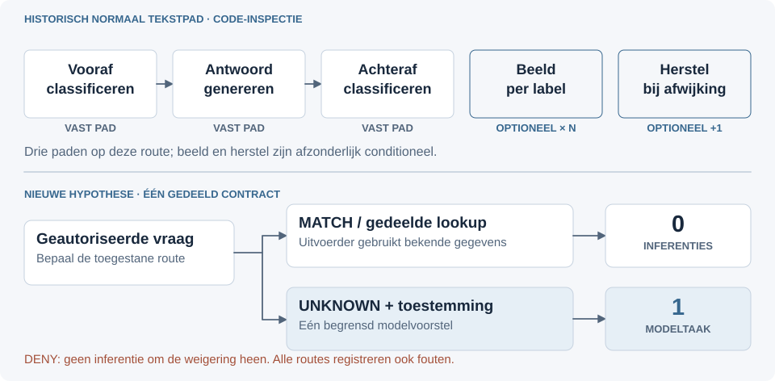
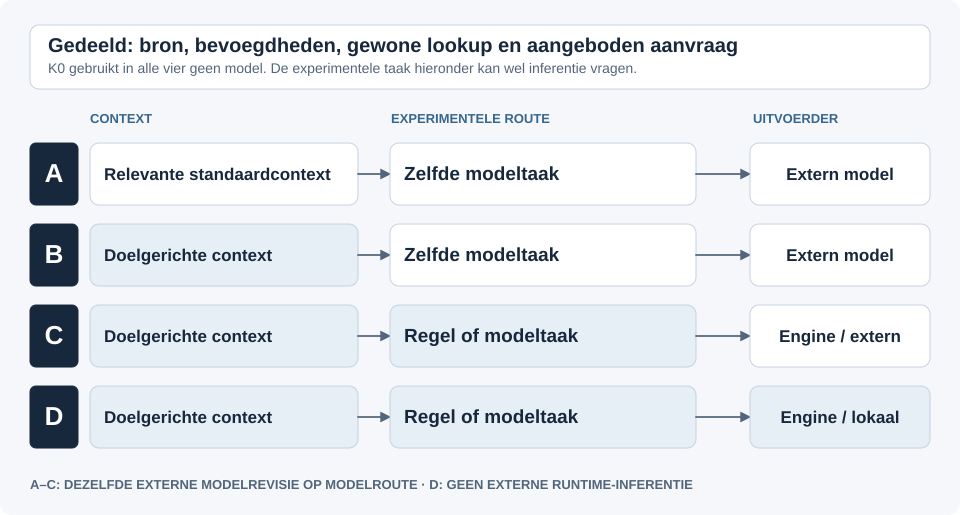
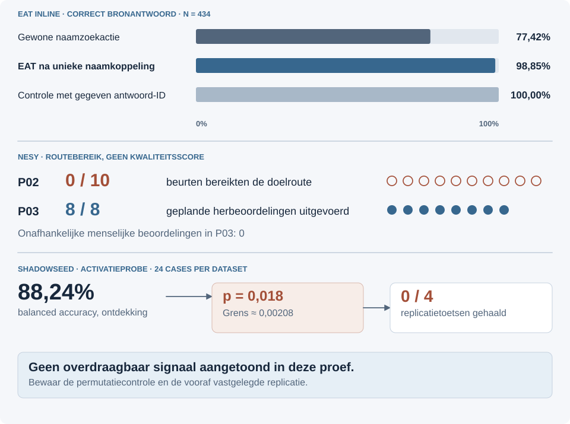
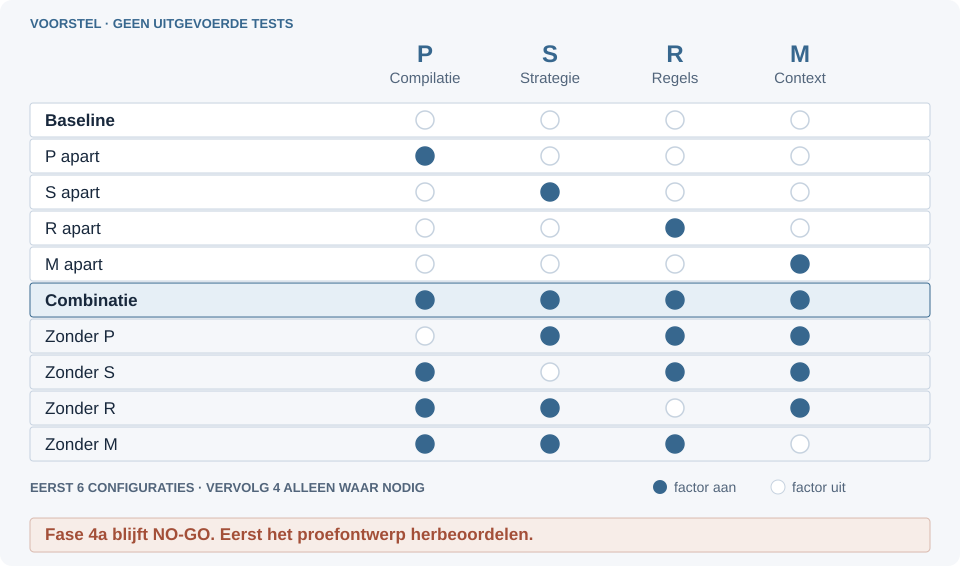

# Een digitale assistent die niet alles opnieuw hoeft te bedenken

We onderzoeken welke technische handelingen gewone software betrouwbaar kan uitvoeren, wanneer een taalmodel nog nodig is en wat dat betekent voor de kosten van hetzelfde aangeboden gesprek. Vooraf compileren, adaptief strategiebehoud, toetsbare beslislogica en selectieve inferentie vormen samen een nieuwe onderzoekshypothese. De onderdelen zijn bekend uit eerdere eigen projecten en openbare implementaties; hun combinatie is nog niet getoetst.

> 27 november 2026 · Herbeoordeling fase 3b/3c. Fase 4a: NO-GO. Geen nieuwe modelproef, vakinhoud, architectuurkeuze of bewezen besparing.

[Zelfstandige HTML-atlas](index.html) · [Combinatiehypothese](../../../research/COMBINATIE-HYPOTHESE.md) · [Machineleesbaar register](atlas-registry.json)

## 01. Kan een deel van het gesprek zonder model?

Vooraf samenstellen, toestand bewaren en alleen inferentie inzetten waar nodig.

Een model hoeft niet bij iedere beurt opnieuw uit te zoeken welke gegevens, regels en mogelijkheden gelden. Een compiler kan die voorbereiding eenmalig uitvoeren. Tijdens het gesprek houdt de software alleen de actuele toestand bij en kiest zij een toegestane handeling.

Het interessante zit in de combinatie: de vooraf gemaakte kaart kan regels en bekende acties begrenzen; strategiebehoud kan onnodige herinterpretatie voorkomen; een regel kan een afgebakende taak zonder model uitvoeren. Een onbekende vraag bereikt alleen een model wanneer dat nodig en toegestaan is. Dit is een hypothese, geen verplichte keten of gekozen architectuur.

**Te toetsen:** Werkt de combinatie ook beter dan elk onderdeel afzonderlijk? Tel voorbereiding en herziening mee; een extra laag die geen werk wegneemt heeft geen voordeel.

Vindplaatsen: DPR04, DPR08–DPR11, DPR27, R10-01–R10-04, R10-09, R11-01–R11-02, R11-13. [SVG openen](d12-combinatie.svg).

## 02. De startsnapshot is niet de actuele toestemming

Houd een versiegebonden artifact apart van de veranderlijke toestand.

De historische selectors voor startsnapshot en actieve voorbereiding zijn bruikbaar, maar een terugval naar oude gegevens mag een ingetrokken recht niet herstellen. Identificeer het artifact met bron-, compiler- en beleidsrevisie en een inhoudsdigest. Houd de veranderlijke sessierevisie apart.

De modeltaak krijgt een projectie van de toegestane gegevens: de lokale vraag, noodzakelijke referenties en het verwachte voorsteltype. Geen volledige bronbundel, onbevoegde historie of vrije code. Cache-identiteit volgt de actuele scope en versie; de cache verleent zelf geen toestemming.

**Te toetsen:** Kan een resultaat uit revisie 1 nog worden getoond nadat de toestand via revisie 2 naar dezelfde waarde is teruggekeerd? Het antwoord moet nee zijn.

Vindplaatsen: DPR09–DPR12, R10-03–R10-04, R10-09–R10-11, R11-05, R11-10. [SVG openen](d13-versies-en-context.svg).

## 03. Strategie vasthouden zonder onzekerheid te verbergen

Constellation locking, hysteresis en adaptieve vensters als afzonderlijke proef.

Eerdere kernels houden een gekozen strategie tijdelijk vast. Hysteresis gebruikt verschillende voorwaarden voor vasthouden en wisselen. Een adaptief venster laat de geldigheidsduur afhangen van het waargenomen veranderingspatroon.

Gewogen entropie kan variatie binnen een reeks expliciete toestandsvelden zichtbaar maken. Onderzoek per veld en over de volledige vector, met een vastgelegde normalisatie en behandeling van ontbrekende waarden. Lage entropie kan ook een stabiele fout zijn. Laat een kritieke gebeurtenis of nieuwe bron- of beleidsrevisie een lock onmiddellijk ongeldig maken. Ontbrekende signalen zijn UNKNOWN, geen bevestiging.

Vergelijk minimaal elke beurt herbeoordelen, een eenvoudige vaste lock, hysteresis zonder entropie en een adaptief venster. Meet echte routewijzigingen, onterechte lock, gemiste interrupt en de kosten van het bepalen van de toestand zelf.

**Te toetsen:** Een extra interpretatiecall om een lock te berekenen kan het hele voordeel tenietdoen. Een stabiele toestand is geen bewijs voor een juist antwoord.

Vindplaatsen: DPR01–DPR08, DPR37, R11-09, R11-13. [SVG openen](d14-strategie.svg).

## 04. Tel alle modelaanroepen, niet alleen het antwoord

Historisch aanroeppad naast een te toetsen selectieve route.

In een oudere eigen implementatie volgden op het normale tekstpad vooraf classificeren, genereren en achteraf classificeren. Beeldlabels konden extra aanvragen veroorzaken; een geconstateerde afwijking kon een herschrijfroute activeren. De streamingroute had een ander pad. De code van de betreffende endpoints bevat echte gatewayaanroepen. Dit zijn aangetroffen paden, geen gemeten frequenties of facturen.

Een efficiënte baseline mag zelf ook een goede directe modeltaak gebruiken. Vergelijk dus niet met een opzettelijk dure keten. Voor de nieuwe hypothese onderzoekt software een bekende bewerking zonder model en stuurt bij UNKNOWN hoogstens één afgebakende modeltaak naar de gekozen adapter. Extra classificatie, embeddings, herstel of controle zijn alleen afzonderlijke onderzoeksmogelijkheden wanneer ze aantoonbaar nodig zijn.

**Te toetsen:** Meet alle aangeboden aanvragen, daadwerkelijke dispatches en pogingen. Een geweigerde dispatch, afgebroken stream of onzekere facturering blijft apart zichtbaar.

Vindplaatsen: DPR27–DPR31, R10-09, R11-03–R11-04, R11-11–R11-12. [SVG openen](d15-modelaanroepen.svg).

## 05. Vier uitvoeringsvormen, geen vier verschillende producten

A–D delen de gevraagde taak en dezelfde technische grenzen.

A blijft een competente reguliere modelroute. B onderzoekt een betere representatie, selectieve context en caching bij dezelfde modeltaak. C onderzoekt een extra, toetsbare modelvrije assistentroute. D gebruikt dezelfde hybride beslisregels, maar voert de resterende modeltaken lokaal uit. Ook embeddings en classificatie mogen in D niet ongemerkt extern draaien.

De combinatiehypothese is geen vijfde product. Onderzoek vooraf compileren, strategiebehoud, lokale logica en begrensde modeltaken eerst afzonderlijk. Houd gewone lookup, authenticatie, revisiecontrole en normale softwarefuncties gelijk. A mag niet slechter worden gemaakt om C gunstig te laten lijken.

Een vergelijking tussen verschillende modelgewichten én hostingvormen bevat twee effecten. Meet waar haalbaar dezelfde gewichten, tokenizer, template en taak op beide hostingvormen. Lokale uitvoering heeft hardware-, energie- en beheerkosten.

**Te toetsen:** Beantwoord eerst de technische vragen op neutrale fixtures. Echte modelkwaliteit en kosten vragen later representatieve gesprekken en vastgelegde kwaliteitscriteria.

Vindplaatsen: S11, S12, DPR09–DPR10, DPR23, DPR26, R11-03–R11-06. [SVG openen](d16-varianten.svg).

## 06. Bewaar ook proeven die niets bewezen

Drie verschillende onderzoeksvragen, drie afzonderlijke bewijsgrenzen.

EAT Inline: 434 vragen naar exacte registernamen op 100.000 gegenereerde documenten, opgebouwd uit 669 fragmenten van 40 Wikipedia-pagina’s. Unieke naamkoppeling met EAT leverde vaker het correcte bronantwoord dan gewone naamzoekactie. De 100%-controle kreeg de antwoord-ID vooraf. Er draaide geen taalmodel.

NeSy: in P02 bereikten nul van tien echte P0-beurten de bedoelde onderzoeksroute. In P03 werden de acht geplande herbeoordelingen wél uitgevoerd, met zes negatieve controles zonder extra call. De verwachte zetten waren door de auteurs bepaald; nul onafhankelijke menselijke beoordelingen waren afgerond. Geen bewezen kwaliteitswinst.

Shadowseed: de historische 88,24% balanced accuracy bij Qwen2.5-0.5B haalde de vooraf vastgelegde statistische grens niet. Op een nieuwe dataset voldeden nul van vier vooraf vastgelegde toetsen. Gebruik die meetmethode als inspiratie, niet de activatieprobe als routecriterium.

**Te toetsen:** Leg vóór uitvoering vast welke route bereikt moet worden, welke meting telt en wanneer een hypothese wordt verworpen. Herhaal geen betaalde proef alleen omdat de eerste geen bruikbaar resultaat gaf.

Vindplaatsen: S02, S08, S09, R10-13–R10-15. [SVG openen](d17-historisch-bewijs.svg).

## 07. Toets de combinatie zonder het antwoord vooraf te kiezen

Een voorgestelde ablatiematrix: meet één wijziging, de combinatie en daarna ontbrekende bijdragen.

Vier factoren maken de combinatie toetsbaar: P = vooraf compileren in plaats van hetzelfde contract per aanvraag opbouwen; S = strategie behouden met expliciete herziening in plaats van de strategie iedere beurt opnieuw bepalen; R = een aantoonbaar toepasselijke experimentele regel in plaats van de modelroute; M = een begrensde taakcontext in plaats van de volledige relevante modelcontext. In de eerste technische vergelijking blijven modelvoorstellen stubs.

Begin met een eerlijke baseline, vier enkelvoudige varianten en de combinatie. Onderzoek daarna zo nodig de combinatie zonder één factor. Dit is een onderzoeksontwerp, geen opdracht om tien runners te bouwen. Gebruik één uitvoerbaar contract met schakelbare factoren, dezelfde aangeboden aanvragen, vooraf vastgelegde verwachtingen en gelijke bevoegdheden. Onderzoek interacties gericht wanneer afzonderlijke effecten niet optellen.

Vooraf samenstellen, cache vullen, toestand observeren, resolver, alle modelpogingen, lokale rekenkracht en herstel horen bij de totale kosten. Rapporteer per aangeboden aanvraag én per geldige afgeleverde uitkomst. In 4a bewijzen stubs alleen bereik, route, versie, budget en foutcontract; geen eurobesparing, semantische kwaliteit of leerresultaat.

**Te toetsen:** Verwerp een variant die goedkoper lijkt door een relevante taak niet uit te voeren, verouderde gegevens af te leveren, UNKNOWN te verbergen of kosten buiten de trace te houden.

Vindplaatsen: S11, S12, DPR04, DPR08–DPR10, DPR27, R10-01, R10-09, R11-01–R11-13. [SVG openen](d18-proefmatrix.svg).

## Bronnen en geschiedenis

De atlas is een leesroute door de onderzoeksbevindingen, geen volledige opsomming van de 112 records uit rondes 09–11. Alle oorspronkelijke registers, bronverwijzingen en elf eerdere diagrammen blijven behouden. Bron-ID’s verwijzen naar het machineleesbare register; besloten bronnen zijn alleen als toegestane afgeleide opgenomen.

- [Ronde 01 · eerste openbare bronronde](../../../research/register/RONDE-01.md)
- [Ronde 09 · 34 openbare bronrecords](../../../research/register/RONDE-09.md)
- [Ronde 09 · 38 afgeleide records](../../../research/register/RONDE-09-AFGELEID.md)
- [Ronde 10 · 26 verdiepingsrecords](../../../research/register/RONDE-10-VERDIEPING.md)
- [Ronde 11 · 14 vergelijkingsrecords](../../../research/register/RONDE-11-VERGELIJKING.md)
- [Machineleesbaar register met alle diagrammen en bron-ID’s](atlas-registry.json)
- [Historische atlas · 11 oorspronkelijke diagrammen](ARCHIEF-V1.md)
- [Historische HTML-atlas · volledige eerdere weergave](archief-v1.html)

## Vormgeving

Eigen HTML/SVG met het bestaande blauwe projectpalet, overzichtelijke routes, afzonderlijke bronmetadata en leesbare bijschriften. Geïnspireerd door [Diagram Design](https://github.com/cathrynlavery/diagram-design/tree/795eec47fd376e5dda0b9e056a49520060cd2f13). De oude atlas blijft intact. Herbouw de primaire atlas met `build-atlas.mjs`; de bronrecords blijven in `atlas-registry.json`.
