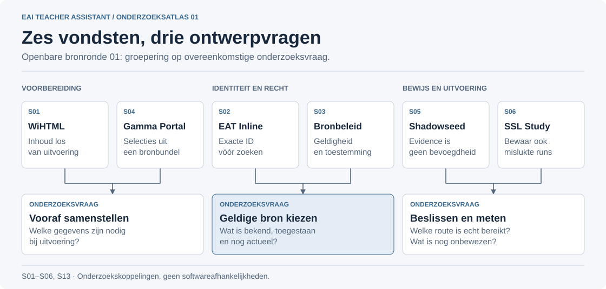
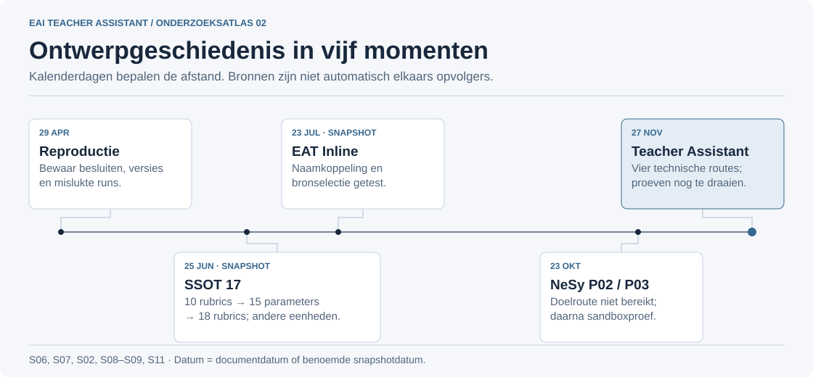
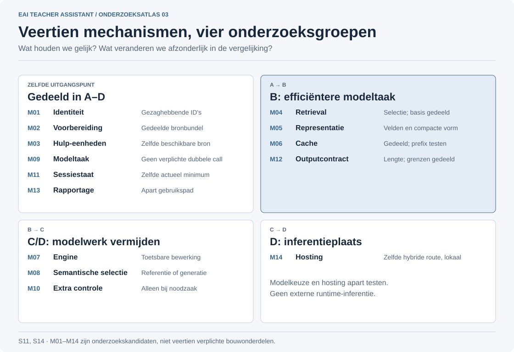
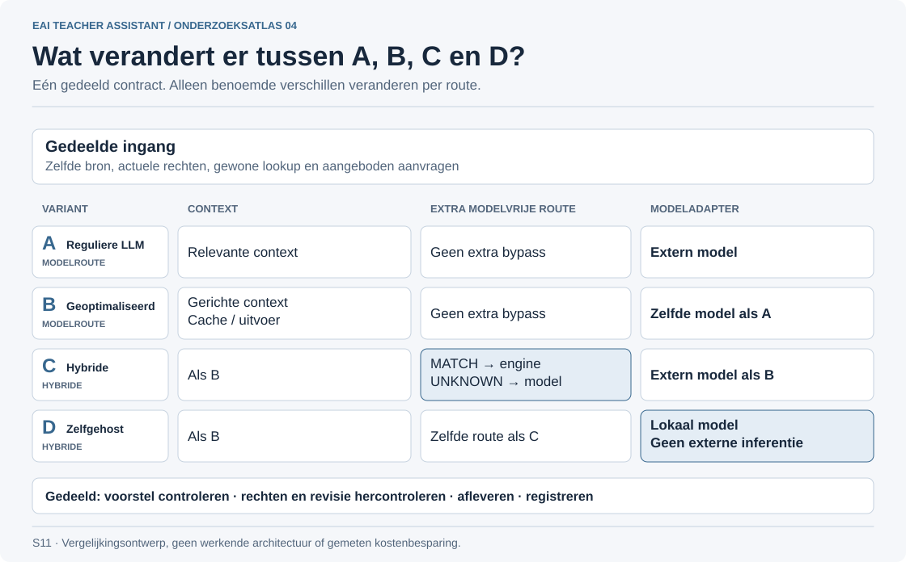
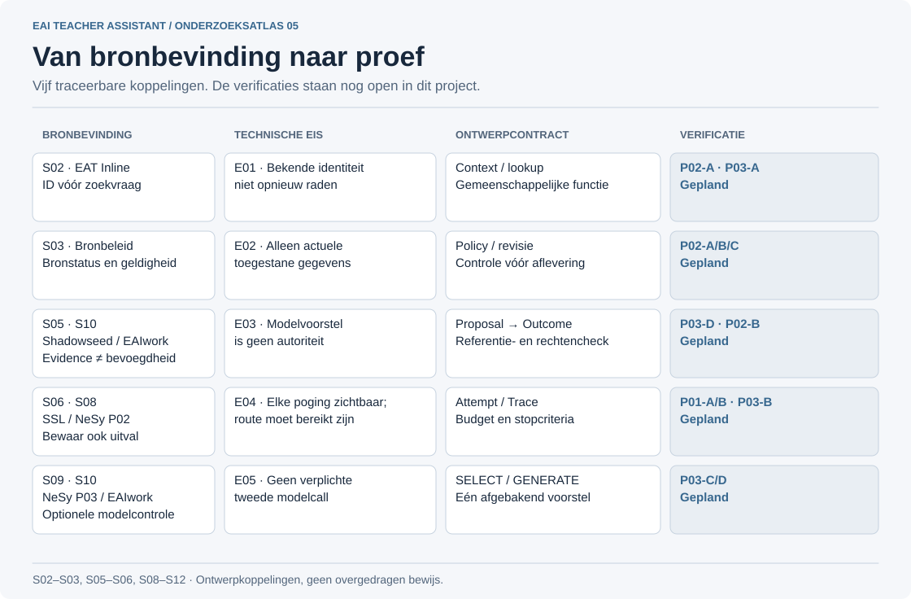
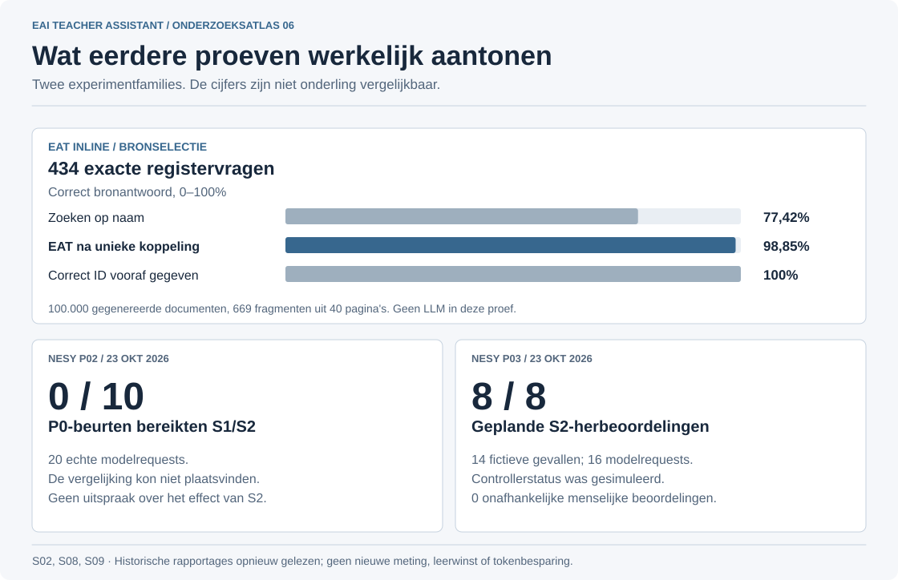
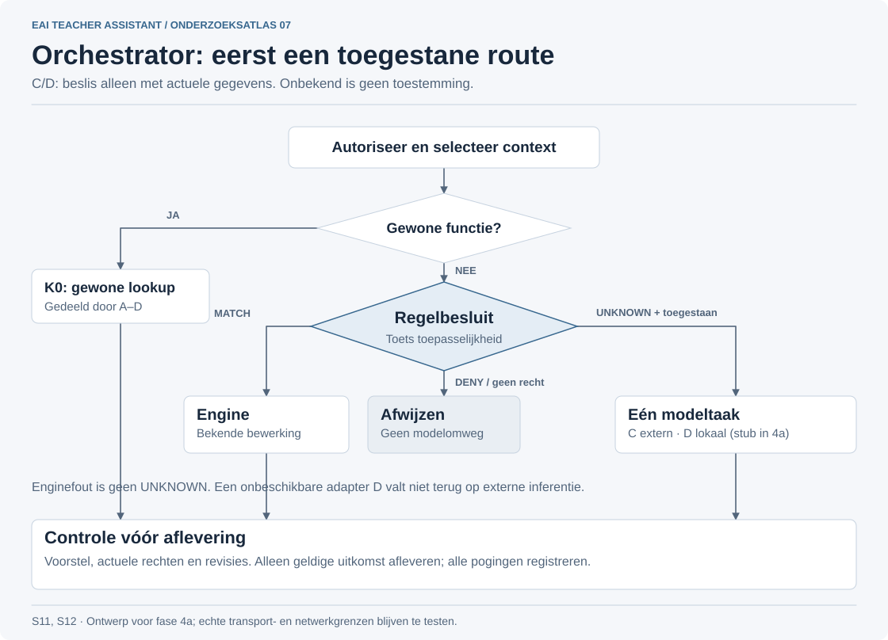

# EAI Teacher Assistant | Onderzoeksatlas

27 november 2026. Zeven diagrammen tonen een beperkte openbare selectie van eerdere bronvondsten en voorgestelde technische vergelijking. Ze vervangen het interne register niet. De selectie is onvoldoende als basis voor het afsluiten van 3b/3c; deze fasen zijn gericht heropend. Fase 4a staat stil tot herbeoordeling. Historische proeven zijn niet opnieuw uitgevoerd.

[Zelfstandige HTML-atlas](index.html) (download en open lokaal) · [Machineleesbaar bronnen- en blokregister](atlas-registry.json) · [Technische specificatie](../../../research/TECHNISCHE-SPECIFICATIE.md) · [P01–P03](../../../benchmarks/TECHNISCHE-PROEVEN.md)

## 01. Zes vondsten, drie ontwerpvragen

Openbare bronronde 01: groepering op overeenkomstige onderzoeksvraag.

[SVG openen](d01-kenniskaart.svg)

## 02. Ontwerpgeschiedenis in vijf momenten

Kalenderdagen bepalen de afstand. Bronnen zijn niet automatisch elkaars opvolgers.

[SVG openen](d02-ontwerpgeschiedenis.svg)

## 03. Veertien mechanismen, vier onderzoeksgroepen

Wat houden we gelijk? Wat veranderen we afzonderlijk in de vergelijking?

[SVG openen](d03-mechanismen.svg)

## 04. Wat verandert er tussen A, B, C en D?

Eén gedeeld contract. Alleen benoemde verschillen veranderen per route.

[SVG openen](d04-varianten-abcd.svg)

## 05. Van bronbevinding naar proef

Vijf traceerbare koppelingen. De verificaties staan nog open in dit project.

[SVG openen](d05-bewijsroute.svg)

## 06. Wat eerdere proeven werkelijk aantonen

Twee experimentfamilies. De cijfers zijn niet onderling vergelijkbaar.

[SVG openen](d06-eerdere-proeven.svg)

## 07. Orchestrator: eerst een toegestane route

C/D: beslis alleen met actuele gegevens. Onbekend is geen toestemming.

[SVG openen](d07-orchestrator.svg)

## Bronregister

Broncodes verwijzen naar openbare, versiegebonden bronnen. Hetzelfde register is machineleesbaar. Elk benoemd blok heeft een vaste `data-block-id`, broncodes en een bewijsstatus in SVG en JSON. Een geplande proef is geen verificatieresultaat. Lijnen tonen de beschreven relatie, niet automatisch afstamming, causaliteit of softwareafhankelijkheid.

| ID | Bron | Bewijssoort | Afbakening |
| --- | --- | --- | --- |
| S01 | [WiHTML · ontwerpafspraken](https://github.com/E-AI-MODEL/wihtml/blob/449d9d9ec3d0f883bd190fc5287eaccfe1d87854/docs/ontwerpafspraken.md) | Ontwerp | Inhoud, lesvolgorde en uitvoering gescheiden; geen bewezen tutor. |
| S02 | [EAT Inline · bronselectieproef](https://github.com/E-AI-MODEL/EAT-inline/blob/0bd184f5408bddb9211b9684d7a0ada78a593b8b/benchmark/results/wiki-fair-v2-one-tag-rag/one-tag-rag-summary.md) | Historische meting | 434 exacte registervragen; 100.000 gegenereerde documenten uit 669 fragmenten van 40 pagina's. Geen LLM. |
| S03 | [Examenreglementcheck · bronbeleid](https://github.com/E-AI-MODEL/Examenreglementcheck/blob/d72dc4806566b9c05f0d8f90f41b972390d5beb5/docs/SOURCE-POLICY.md) | Beleidsontwerp | Identiteit, geldigheid en bevoegdheid onderscheiden; geen juridische regels overgenomen. |
| S04 | [Gamma Portal · SSOT-selectors](https://github.com/E-AI-MODEL/eai-gamma-portal/blob/444d1373f83dcd2d5ace6f0ad931c448874b7807/src/lib/ssot-selectors.ts) | Code-inspectie | Selecties met bronverwijzingen; geen bewezen tutorwerking. |
| S05 | [Shadowseed Agent Lab · evidence en invloed](https://github.com/E-AI-MODEL/shadowseed-agent-lab/blob/d50971ac8aed51e1f4442ff3baac9328e36ad75e/docs/architecture-decisions/0002-rag-as-evidence-not-influence.md) | Ontwerpbesluit | Gevonden informatie krijgt niet automatisch invloed; uitvoering niet opnieuw geverifieerd. |
| S06 | [Shadow Seed Study · reproductienotitie](https://github.com/E-AI-MODEL/shadow-seed-study/blob/ff639cc8c079cabef06c4d8cd9bcfb90c72a3b40/docs/ssl/notitie_reproductie.md) | Methode | 29 april 2026: beslissingen, versies, ruwe resultaten en mislukte runs bewaren. |
| S07 | [SSOT 17 · migratiekaart](https://github.com/E-AI-MODEL/SSOT_17/blob/66a48584ed5818790828c1a0fdc41b9a1880df43/docs/11_MIGRATION_MAP.md) | Versiemapping | Snapshot 25 juni 2026: 10 rubrics, 15 Gamma-parameters, 18 operationele rubrics; verschillende eenheden. Geen effectmeting of hergebruikrecht. |
| S08 | [NeSy P02 · postmortem](https://github.com/E-AI-MODEL/eainesy/blob/e8ce553a3c1c16d072078a62c426ce038cc455d3/docs/NeSy-P02-run-failure-root-cause-2026-10-23.md) | Mislukte historische proef | 23 oktober 2026: 0/10 P0-beurten bereikte de onderzochte S1/S2-route; 20 echte modelrequests. Geen vergelijking van S1/S2. |
| S09 | [NeSy P03 · resultaat](https://github.com/E-AI-MODEL/eainesy/blob/e8ce553a3c1c16d072078a62c426ce038cc455d3/docs/NeSy-P03-result-2026-10-23.md) | Historische sandboxmeting | 14 fictieve gevallen; 8/8 S2-herbeoordelingen; 6 controles zonder extra call; 16 modelrequests; 0 onafhankelijke menselijke beoordelingen. Controllerstatus gesimuleerd. |
| S10 | [EAIwork · model-capability neutral](https://github.com/E-AI-MODEL/EAIwork-/blob/8754936ffe594766339e8f8493c963c41a0b4206/docs/model-capability-neutral.md) | Implementatiebeschrijving | Optionele voorstelcontrole; gewone directe modelroute behouden. Exact citaat bewijst geen semantische steun. |
| S11 | [Technische specificatie v0.1](https://github.com/E-AI-MODEL/EAI-teacher-assistent/blob/f19d9b8885fad221524a28dacd2a2aecae3aa056/research/TECHNISCHE-SPECIFICATIE.md) | Projectontwerp | Gedeeld contract A–D; geen werkende architectuur. |
| S12 | [Technische proeven P01–P03](https://github.com/E-AI-MODEL/EAI-teacher-assistent/blob/f19d9b8885fad221524a28dacd2a2aecae3aa056/benchmarks/TECHNISCHE-PROEVEN.md) | Geplande verificatie | Nog niet uitgevoerde modelvrije contractproeven. |
| S13 | [Openbare bronronde 01](https://github.com/E-AI-MODEL/EAI-teacher-assistent/blob/f19d9b8885fad221524a28dacd2a2aecae3aa056/research/register/RONDE-01.md) | Openbaar bronnenregister | Zes bronvondsten met beperkingen. |
| S14 | [Technische audit](https://github.com/E-AI-MODEL/EAI-teacher-assistent/blob/f19d9b8885fad221524a28dacd2a2aecae3aa056/research/TECHNIEKAUDIT.md) | Technische verkenning | Kandidaatmechanismen; geen nieuwe runtimeproef. |

## Vormgeving en onderhoud

Geïnspireerd door [Diagram Design van Cathryn Lavery](https://github.com/cathrynlavery/diagram-design/tree/795eec47fd376e5dda0b9e056a49520060cd2f13) (MIT). Eigen HTML/SVG met het bestaande projectpalet, sobere typografie, orthogonale verbindingen, één accentkleur en afzonderlijke bronmetadata. Geen upstream code of assets gekopieerd, geen nieuwe afhankelijkheid. De SVG's zijn bewerkbaar; het HTML-bestand bundelt exact dezelfde beelden zonder externe fonts of scripts. Houd bij wijzigingen SVG, HTML en register in overeenstemming. De atlas is een openbare selectie, geen volledige interne inventarisatie.
