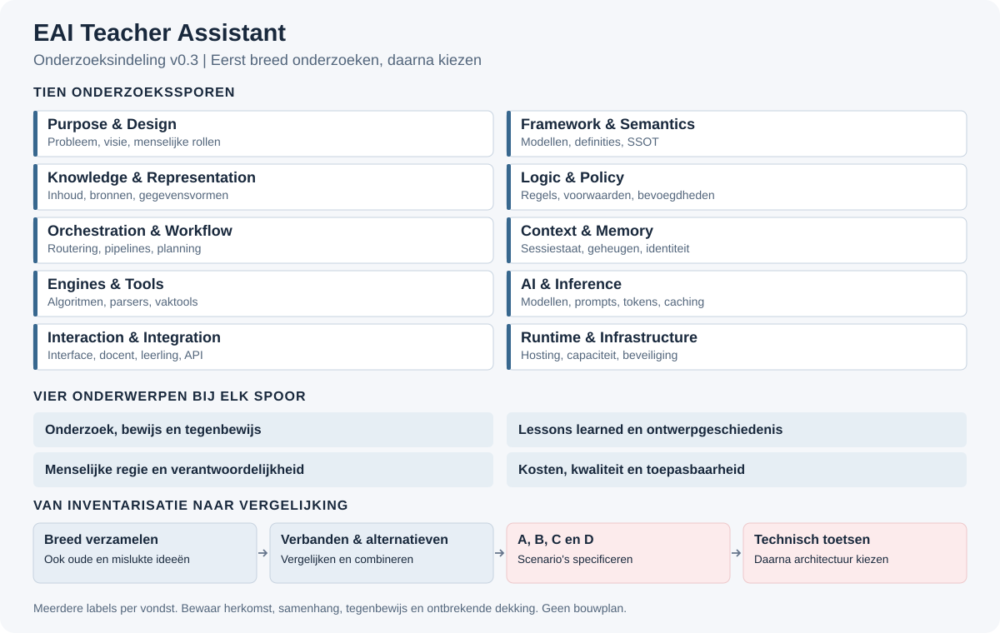

# Onderzoeksindeling

Versie 0.3, 27 november 2026. Vastgelegd na een kritische tegenlezing van de voorgestelde indeling. Dit is een werkwijze om ideeën terug te vinden en te vergelijken, geen softwarearchitectuur.

## Doel en afbakening

We onderzoeken hoe een methodegebonden digitale assistent passende hulp kan geven tegen lagere totale kosten, ook bij grote aantallen leerlingen. We beginnen breed. De eerste technische selectie is een verzameling kandidaten, geen filter waarmee we andere ideeën uitsluiten.

Eigen repositories, oudere accounts, historische versies, bibliotheekdocumenten, boeken, specificaties, onderzoek, ruwe resultaten, ontwerpbesluiten, issues, reviews en commitgeschiedenis kunnen allemaal relevante bronnen zijn. Neem ook bestaande externe oplossingen en tegenbewijs mee. De hoeveelheid uniek materiaal en de volledigheid van de dekking zijn nog niet vastgesteld.

We onderscheiden oorspronkelijke ontwerpgedachten, actuele inhoudelijke betekenis en technisch bruikbare mechanismen. Een oude implementatie kan een waardevolle gedachte bevatten; een recente implementatie kan op een verkeerde aanname berusten. Behoud ook mislukte experimenten, verlaten oplossingsroutes en nog onbeantwoorde vragen. Hergebruik geen oude inhoud of code zonder actualiteits- en rechtencontrole.

## Tien onderzoekssporen

| ID | Onderzoeksgebied | Onderwerpen | Leidende vraag |
| --- | --- | --- | --- |
| PUR | Purpose & Design | Probleem, visie, menselijke rollen | Waarom is deze oplossing bedacht? |
| FRM | Framework & Semantics | Modellen, definities, SSOT | Welke betekenis en afspraken gelden? |
| KNW | Knowledge & Representation | Inhoud, bronnen, gegevensvormen | Wat is bekend en hoe is het vastgelegd? |
| LOG | Logic & Policy | Regels, voorwaarden, bevoegdheden | Wat mag of moet gebeuren? |
| ORC | Orchestration & Workflow | Routering, pipelines, planning | Wie of wat voert welke stap uit? |
| CTX | Context & Memory | Sessiestaat, geheugen, identiteit | Wat is nu relevant en geldig? |
| ENG | Engines & Tools | Algoritmen, parsers, vaktools | Welke bewerking kan worden uitgevoerd? |
| AI | AI & Inference | Modellen, prompts, tokens, caching | Wanneer heeft een model toegevoegde waarde? |
| INT | Interaction & Integration | Interface, docent, leerling, API | Hoe werken mensen en systemen samen? |
| RUN | Runtime & Infrastructure | Hosting, capaciteit, beveiliging | Wat vraagt de uitvoering aan middelen? |

De ID's dienen uitsluitend voor het terugvinden en verbinden van materiaal. Ze zijn geen EAI-classificaties, scores, ontwikkelstappen of verplichte modules. Een idee kan bij meerdere sporen horen. Voeg een spoor toe of splits een bestaand spoor wanneer materiaal daar aanleiding toe geeft; leg de wijziging en reden vast. Plaats niet een hele repository in één categorie.

### Begrippen uit elkaar houden

Een framework beschrijft de samenhang en uitgangspunten. Een SSOT legt gezaghebbende gegevens, begrippen of regels vast; een opgeslagen bestand bewijst niet dat een runtime ze daadwerkelijk gebruikt. Policy bepaalt wat is toegestaan. Beslislogica kiest of begrenst een beslissing aan de hand van beschikbare informatie. Een orchestrator kiest en coördineert uitvoerders. Een pipeline voert verwerkingsstappen uit en kan ook zonder orchestrator bestaan. Een engine of tool verricht een specifieke bewerking. Een runtime is de omgeving waarin dit werk plaatsvindt. AI kan in verschillende van deze functies een rol spelen, maar is niet automatisch de beslisser. Deze begrippen kunnen in één implementatie samenkomen; onderzoek hun afzonderlijke verantwoordelijkheden en de verbindingen ertussen.

## Vier onderwerpen bij ieder onderzoeksitem

| Onderwerp | Vraag |
| --- | --- |
| Onderzoek, bewijs en tegenbewijs | Wat is aangetoond? Onder welke voorwaarden? |
| Lessons learned en ontwerpgeschiedenis | Waarom is iets veranderd, behouden of verlaten? |
| Menselijke regie en verantwoordelijkheid | Wie beslist, handelt, controleert en kan ingrijpen? |
| Kosten, kwaliteit en toepasbaarheid | Wat levert het op, voor wie, met welke beperkingen? |

Bewaar onderzoek en negatieve resultaten bij het mechanisme waarop zij betrekking hebben. Een samenvatting mag een oorspronkelijke bron niet vervangen. Beschrijf wie de handeling uitvoert: leerling, docent, auteur, gewone software of AI. Ook een systeem zonder LLM kan een belangrijke leerhandeling of beslissing overnemen. Kostenbesparing, kwaliteit van hulp en zelfstandig leren zijn afzonderlijke uitkomsten.

## Onderzoeksregister: klein beginnen, verbanden behouden

Leg een vondst vast als één herleidbaar idee, mechanisme, ontwerpbesluit of onderzoeksbevinding. Een samengestelde route blijft ook als samenhangend geheel beschreven. Gebruik de volgende gegevens waar ze relevant zijn:

- Unieke ID, titel, oorspronkelijk probleem en bedoeling.
- Een of meer onderzoekssporen en relaties met andere vondsten, voorgangers, opvolgers en alternatieven.
- Bronlocatie, eigenaar/toegang, datum, exacte versie of commit en relevante passage of bestand. Leg ook vast wat niet toegankelijk of niet gelezen was.
- Oorspronkelijk ontwerp en wat er daadwerkelijk is geïmplementeerd. Onderscheid een specificatie, code-inspectie, aanwezige test, uitgevoerde test en gemeten effect. Een document kan meerdere soorten bewijs bevatten.
- Bevindingen, tegenbewijs, mislukte proeven, meetcondities, bekende beperkingen en nog openstaande vragen. Geen ontbrekend bewijs als nul of afwijzing registreren.
- Relevante menselijke handelingen, modeltaken, technische voorwaarden, onderhoud, kosten en hergebruikrechten.
- Mogelijke betekenis voor dit onderzoek. Status: gevonden, in onderzoek, onderbouwde kandidaat, twijfel, niet gekozen of later heroverwegen. Noteer de reden; een keuze wist geen eerder idee.

Gebruik geen samengestelde score. Vergelijk waar mogelijk de onderliggende waarnemingen. Bewaar verschillende versies en conflicterende resultaten. Gekopieerde bestanden, forks, herhaalde tests en samenvattingen van dezelfde bron gelden niet als onafhankelijk bewijs. Koppel ze aan hun herkomst en voorkom dubbeltelling.

De openbare projectrepository bevat alleen materiaal dat openbaar mag worden gemaakt. Voor niet-openbare bronnen blijven de inhoud, de vindplaats en de details van interne bevindingen in een daarvoor toegestane omgeving. Publiceer uitsluitend toegestane algemene conclusies en openbare bronverwijzingen. Het volledige interne bronnenregister wordt apart bewaard in een private werkruimtepagina. De huidige 87 toegankelijke repositories zijn daarin opgenomen, inclusief historische dekkingsstatus. De [openbare index](register/public-repositories.json) bevat uitsluitend de openbare afgeleide. Zichtbaarheid bepaalt niet of een bron wordt onderzocht. Controleer beide registers bij wijzigingen in toegang, dekking of bronversie.

## Van breed naar gericht

| Stap | Werk | Resultaat |
| --- | --- | --- |
| Breed verzamelen | Zoek ook buiten de al bekende repositories en onderzoekssporen. Neem oude ontwerpen en mislukkingen mee. | Bronnenkaart, herleidbare vondsten en ontbrekende dekking |
| Verbanden onderzoeken | Volg de ontwikkeling van ideeën, vergelijk varianten en zoek tegenbewijs. | Ontwerpgeschiedenis en samenhang tussen mechanismen |
| Vergelijken en combineren | Onderzoek eenvoudige en bestaande alternatieven, verschillende volgordes van logica, inhoud en AI, en combinaties van mechanismen. | Verdedigbare hypotheses, beperkingen en nog open vragen |
| A–D specificeren | Werk de vier scenario's uit vanuit de bevindingen, inclusief de verschillen in taken, aanroepen en kosten. | Vergelijkbare functionele en technische specificaties |
| Technisch toetsen | Kies proeven die de hypotheses daadwerkelijk van elkaar onderscheiden. | Reproduceerbaar bewijs voor een architectuurbesluit |

De brede inventarisatie eindigt niet op een willekeurig aantal bestanden. Voor de overgang naar de specificatie benoemen we de onderzochte projectfamilies, bronsoorten en nog relevante hiaten; leggen we vast welke tegenvoorstellen en negatieve bevindingen zijn meegenomen; en motiveren we waarom de nog openstaande vragen een eerlijke vergelijking niet in de weg staan. Een materieel nieuw idee kan aanleiding geven de vergelijking opnieuw te openen. Geen volledige herlezing van alle code als doel op zich.

## Status van A–D

De brede inventarisatie is bewaard. Fase 3b en 3c worden gericht heropend: de eerdere openbare selectie laat belangrijke mechanismen, alternatieven en tegenbewijs onvoldoende zien. De interne bronregistratie blijft leidend. Er is geen volledige audit van alle repositories geclaimd.

A (reguliere LLM), B (geoptimaliseerde LLM met dezelfde modelrevisie), C (hybride) en D (zelfgehoste hybride zonder externe runtime-inferentie) zijn technisch uitgewerkt in de [specificatie v0.1](TECHNISCHE-SPECIFICATIE.md). De vier delen één contract en gewone softwarefuncties. Mechanismen kunnen binnen de varianten afzonderlijk worden onderzocht. De specificatie legt geen productiearchitectuur, definitief model, hostingkeuze of inhoud vast.

De [minimale proeven P01–P03](../benchmarks/TECHNISCHE-PROEVEN.md) blijven een voorstel. NO-GO voor fase 4a totdat de technische alternatieven en de specificatie opnieuw zijn beoordeeld. De beoogde modelvrije fixtures en stub-adapters toetsen technische grenzen, niet modelkwaliteit, vakinhoudelijke geschiktheid, leren of echte kosten.

Zie het [plan v0.4](../docs/PLAN.md), de [eerste technische selectie](TECHNIEKAUDIT.md) en [functionele analyse](FUNCTIONELE-EISEN.md). De indeling blijft een onderzoekswerkwijze, geen voorgeschreven architectuur.
